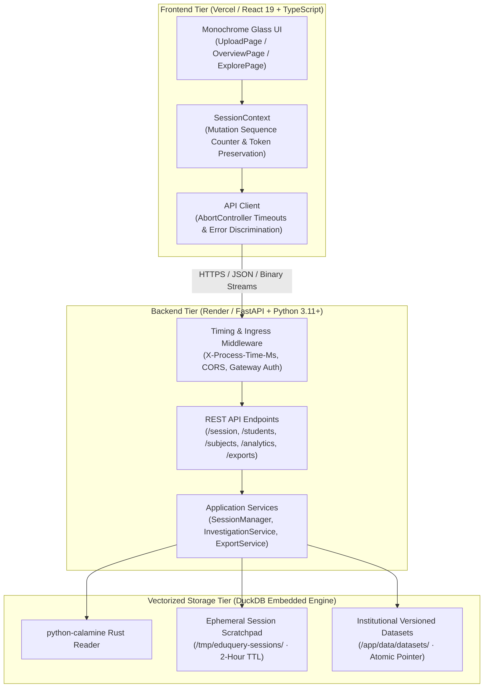

<div align="center">

# 🎓 EduQuery

**Deterministic Academic Marksheet Intelligence & Verification Engine**

[](https://www.python.org/)
[](https://fastapi.tiangolo.com)
[](https://duckdb.org/)
[](https://react.dev/)
[](https://www.typescriptlang.org/)
[](LICENSE)
[](#testing--verification)

<p align="center">
  <a href="#overview">Overview</a> •
  <a href="#key-capabilities">Key Capabilities</a> •
  <a href="#architecture">Architecture</a> •
  <a href="#benchmarks">Benchmarks</a> •
  <a href="#quick-start">Quick Start</a> •
  <a href="#documentation">Documentation</a> •
  <a href="#citation">Citation</a>
</p>

---

</div>

## Overview

Academic institutions routinely handle high-stakes semester marksheets formatted as unstandardized, multi-tier merged Excel spreadsheets. Manual validation of student results, subject backlogs, Multidisciplinary Minor (MDM) electives, and accreditation statistics (NBA/NAAC) is notoriously slow, fragile, and prone to calculation error.

**EduQuery** replaces error-prone spreadsheet macros with an **in-process, vectorized analytical engine** powered by **FastAPI** and **DuckDB**. It processes semester marksheets with **sub-second speed**, provides verifiable cohort-wide analytics, and guarantees strict **source-cell provenance** without modifying original academic records.

---

## Why EduQuery?

| Capability | Traditional Spreadsheet / Manual Workflow | EduQuery Vectorized Engine |
| :--- | :--- | :--- |
| **Ingestion Speed** | 10–30 minutes of manual alignment & formulas | **~740 ms** via parallel Rust `calamine` extraction |
| **Data Integrity** | Silent formula errors, truncated decimals, zero vs. absent confusion | **Strict Five-State Semantics** (`marked`, `flagged`, `uncalculated`, etc.) |
| **Electives (MDM)** | Phantom warnings; wrong cohort denominators | **Elective-Aware Resolution**; failure rates calculated per enrolled student |
| **Audit Provenance** | Lost origin context across aggregated tabs | **Cell-Level Provenance**; exact `Source Sheet` & `Source Row` in every export |
| **Privacy / Security** | Student data permanently left on desktop machines | **Zero-Retention Default**; ephemeral in-memory DuckDB sessions (2-hr TTL) |
| **Export Safety** | CSV formula injection vulnerable (`=cmd`, `@SUM`) | **Hardened Sanitization**; single quotes prepended to trigger tokens |

---

## Key Capabilities

### ⚡ Sub-Second Rust & DuckDB Ingestion
- Ingests raw semester spreadsheets in parallel using the `python-calamine` Rust extension.
- Employs DuckDB's vectorized Appender API to load thousands of student assessment components into memory in under 800 ms.

### 🛡️ Five-State Assessment Semantics
Every cell is deterministically classified into one of five mutually exclusive states:
1. `marked`: Valid numeric score, with optional suffix flag (e.g., `'45'`, `'32F'`).
2. `flagged`: Explicit non-numeric status marker (e.g., `'AB'`, `'ABS'`).
3. `uncalculated`: Explicit absent or placeholder indicator (`'-'`, `'NA'`).
4. `not_enrolled`: Clean empty cell representing an elective un-offered to that student.
5. `unparsed`: Malformed text surfaced immediately for faculty review.

### 🔍 Interactive Cohort Investigation Engine
- Multi-condition boolean query builder (`AND` / `OR`) supporting complex academic filters:
  - Confirmed failed courses, zero backlogs, division splits, SGPI ranges, and absence thresholds.
- **Correlated SQL with `COALESCE`:** Mathematically guarantees accurate calculations for students with zero backlogs (`failed_subject_count = 0`).
- **Exact Token Flag Matching:** Evaluates comma-delimited component flags (`(',' || flags || ',') LIKE '%,F,%'`), rejecting false positives from strings like `OFFLINE` or `FIRST_CLASS`.

### 📊 Comprehensive Multi-Format Exports
- Generates official, publication-ready Excel (`.xlsx`), CSV, and PDF reports.
- Includes exact source provenance columns (**`Source Sheet` at N5** and **`Source Row` at O5**).
- Full-range table auto-filters (`A5:O{last_row}`) and frozen header panes (`A6`).
- Automatic spreadsheet formula injection protection.

---

## Architecture

EduQuery follows a modern, decoupled layered architecture separating ingress security, service coordination, domain invariants, and vectorized analytical storage.



For complete architectural specifications, layer boundaries, and schema definitions, see [`docs/architecture.md`](./docs/architecture.md).

---

## Benchmarks

Measurements recorded across representative university marksheet workbooks (Windows 11, Python 3.14.2, DuckDB 1.5.6):

| Workbook | Cohort Profile | File Size | Core Ingestion (`calamine` + DuckDB) | Full Pipeline (`create_temporary_session`) |
| :--- | :--- | :---: | :---: | :---: |
| **`Result_anonymized.xlsx`** | **145 Students, 27 Courses** | **154.9 KiB** | **740.30 ms** | **868.24 ms** |
| `test1_commerce.xlsx` | 20 Students, 10 Courses | 20.4 KiB | 103.98 ms | 167.71 ms |
| `test1_engineering.xlsx`| 20 Students, 10 Courses (3 Divs) | 20.3 KiB | 101.97 ms | 217.63 ms |
| `test2_lifesciences.xlsx`| 15 Students, 8 Courses | 12.9 KiB | 81.30 ms | 175.44 ms |
| `test3_arts.xlsx` | 18 Students, 9 Courses | 15.6 KiB | 89.94 ms | 186.11 ms |

- **Frontend Initial Mount:** `< 100 ms` (Immediate non-blocking upload workspace).
- **Warm Session Verification:** `15–25 ms`.
- **Total Local HTTP Round-Trip:** `~837 ms` on the 145-student cohort.

For full benchmark methodology and latency decomposition, see [`docs/production-performance-and-reliability.md`](./docs/production-performance-and-reliability.md).

---

## Quick Start

### Prerequisites
- **Python:** 3.11, 3.12, 3.13, or 3.14
- **Node.js:** $\ge$ 18.x and `npm`
- **Git**

---

### Local Development Setup

#### 1. Backend

```bash
# Clone the repository
git clone https://github.com/armash66/edu-query.git
cd edu-query

# Create and activate virtual environment
# Windows (PowerShell):
python -m venv .venv
.venv\Scripts\Activate.ps1

# Linux / macOS:
python3 -m venv .venv
source .venv/bin/activate

# Install dependencies
pip install -r requirements.txt

# Run backend development server
python -m uvicorn app.main:app --host 127.0.0.1 --port 8000 --reload
```

#### 2. Frontend

In a separate terminal:

```bash
cd frontend

# Install frontend dependencies
npm install

# Start Vite development server
npm run dev
```

Visit [`http://localhost:5173`](http://localhost:5173) in your browser. Interactive API documentation is available at [`http://127.0.0.1:8000/docs`](http://127.0.0.1:8000/docs).

---

### Docker Deployment

To build and run the production-grade multi-stage container:

```bash
# Build production Docker image
docker build -t eduquery:latest .

# Run containerized application
docker run -p 8000:8000 --rm eduquery:latest
```

The container automatically serves the compiled React single-page application and the FastAPI backend unified on port `8000`.

---

## Testing & Verification

EduQuery is maintained under comprehensive automated regression testing:

```bash
# Run backend test suite (328 passed)
python -m pytest -q

# Run frontend test suite (107 passed)
cd frontend
npm run test:run

# Verify TypeScript compilation and production build
npm run build
```

---

## Documentation

The [`docs/`](./docs/) directory contains in-depth architectural and operational specifications:

- 📄 [`docs/production-performance-and-reliability.md`](./docs/production-performance-and-reliability.md) — Production performance engineering, session restoration, ingestion profiling, and SQL correctness.
- 📐 [`docs/architecture.md`](./docs/architecture.md) — System boundaries, database concurrency, and domain layer architecture.
- 🔒 [`docs/security.md`](./docs/security.md) — Faculty Identity Gateway (RS256 JWT), CORS security, and threat modeling.
- 📊 [`docs/data-handling.md`](./docs/data-handling.md) — Marksheet parsing rules, five-state induction, and MDM elective invariants.
- 🔬 [`docs/investigation-engine.md`](./docs/investigation-engine.md) — Multi-condition query grammar, AST translation, and presets.
- 📑 [`docs/api-contract.md`](./docs/api-contract.md) — Complete REST endpoint schemas and error envelopes.

---

## Citation

If you use EduQuery in your research or academic administration workflows, please cite:

```bibtex
@software{ansari2026eduquery,
  author       = {Ansari, Armash},
  title        = {EduQuery: Deterministic Academic Marksheet Intelligence & Verification Engine},
  year         = {2026},
  publisher    = {GitHub},
  journal      = {GitHub repository},
  howpublished = {\url{https://github.com/armash66/edu-query}},
  version      = {3.0.0}
}
```

---

## License

This project is licensed under the MIT License — see the [LICENSE](LICENSE) file for details.
