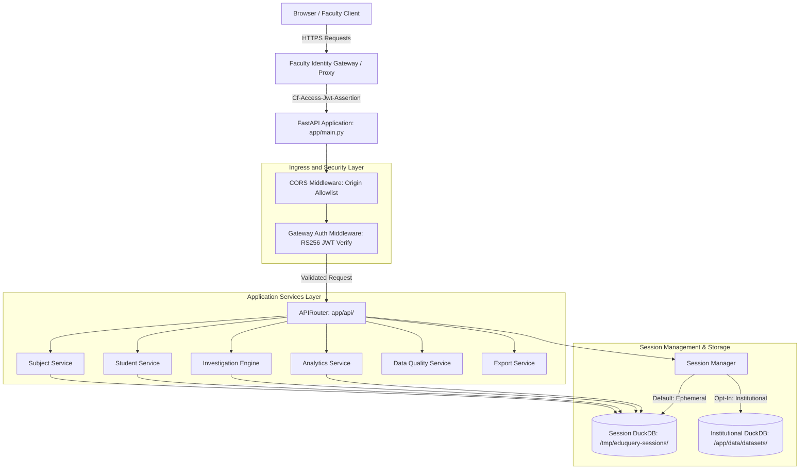

# EduQuery: Academic Marksheet Analysis Engine

EduQuery is a deterministic academic marksheet analysis platform designed for university faculty, departmental heads, and academic administrators. It automates the parsing, validation, reconciliation, and audit of unstandardized college semester marksheets (such as Mumbai University Excel spreadsheets with multi-tier merged headers and multi-division structures).

The platform replaces manual spreadsheet calculations with an in-process vectorized analytical engine, providing verifiable student performance breakdowns, curriculum-wide failure rates, multi-condition cohort investigations, and noise-reduced anomaly detection.

---

## Project Status

- Version: EduQuery (Production Ready)
- Verification Status: Locally verified with 100% test pass rate across 279 backend Pytest tests, 61 frontend Vitest tests, strict TypeScript checks, and production bundle builds.
- Deployment Status: Containerized and configuration-ready. Production blueprints are prepared for Render (`render.yaml`) and Vercel (`vercel.json`).
- Remote Verification Note: Local automated test suites establish that all application components, security gates, JWT validators, and static builds function as specified. They do not establish that remote Render, Vercel, and an external institutional identity provider have been tested together until live cloud infrastructure is provisioned and bound.
- Core Shift: Replaces experimental natural-language query and LoRA fine-tuning pipelines from V1/V2 with a deterministic, dashboard-first architecture.

---

## Overview

Academic institutions generate marksheet spreadsheets that feature complex merged headers, varied grading rules, and non-uniform layouts across divisions. Manually extracting departmental pass rates, tracking student backlogs, and preparing accreditation statistics (such as NBA or NAAC documentation) is slow and prone to calculation errors.

EduQuery provides a workflow tailored to faculty needs:
1. Upload & Ingest: Drag-and-drop raw semester marksheets (.xlsx).
2. Layout Induction: The engine automatically determines table boundaries, student identity anchors, component structures, and elective courses.
3. Pre-Activation Validation: Academic integrity checks identify duplicate student IDs, out-of-range marks, absence anomalies, and elective conflicts before cohort activation.
4. Privacy-First Session: Analysis runs in an ephemeral, isolated in-memory DuckDB session by default (zero permanent storage). Institutional dataset persistence is opt-in.
5. Cohort Intelligence: Faculty explore division performance, identify high-failure courses, query specific student cohorts using multi-condition filters, and review data-quality findings.
6. Sanitized Exports: Roster and failure reports are exported to CSV with formula-injection neutralization and single-use download ticket authentication.

---

## Features

### 1. Adaptive Workbook Ingestion & Layout Induction
- Automatically classifies multi-tier merged headers, single-row vs. paired-row formats, and multi-sheet workbooks (`Div A`, `Div B`).
- Normalizes floating-point assessment marks while preserving original cell provenance (`source_sheet`, `source_row`).
- Correctly distinguishes valid numeric zeros (`0.0`) from absence markers (`AB`, `ABS`).

### 2. MDM Elective Semantics & Enrolled Denominators
- Enforces mutually exclusive single-choice elective selection (1 of N) across Multidisciplinary Minor groups.
- Unselected elective alternatives generate zero phantom records, grades, or misleading mismatch warnings.
- Course failure rates calculate strictly against the enrolled denominator rather than the full class cohort.

### 3. Academic Integrity Validator (Checks 1 to 10)
- Detects duplicate student identities, missing roll numbers, and unparseable score cells (blocking errors).
- Surfaces out-of-range marks (e.g. elective composite totals exceeding 100) as non-blocking data quality warnings without silent clamping or truncation.
- Reconciles printed totals against computed component sums.

### 4. Interactive Cohort Investigation Engine
- Flexible multi-condition filter builder supporting AND/OR combination logic.
- Filter criteria by division, overall result, total score, SGPI, course enrollment, and component score thresholds.
- Pre-configured academic presets: Multi-Course Failures, High Scorers with At-Risk Components, Borderline Students, and Course Failure Cohorts.

### 5. Curriculum-Wide Subject Failure Analysis
- Roster of confirmed failures per subject with component score breakdowns (Internal, Mid-Sem, End-Sem, Practical).
- Sortable failure summaries with division-level partition reconciliation.

### 6. Noise-Reduced Anomaly Detection
- Multi-tiered anomaly detection: deterministic calculation discrepancies (Tier A) and multivariate Isolation Forest outliers (Tier C).
- Decouples statistical tail noise from default faculty screens while providing persistent review feedback loops per dataset.

### 7. Dual Storage Topology & Privacy Controls
- Ephemeral Analysis (Default): Isolated DuckDB sessions in temporary memory, cleared on session deletion or idle TTL expiration.
- Institutional Storage (Opt-In): Persistent versioned dataset storage with atomic active pointer swaps.

---

## Screenshots

Representative screenshots and visual walkthroughs of the user interface are documented in the design specification [`docs/phase9-minimalist-design-report.md`](./docs/phase9-minimalist-design-report.md). To comply with student data privacy standards, all published visual assets use anonymized synthetic datasets.

---

## Architecture

EduQuery is built as a layered system separating network ingress, REST controllers, application services, domain classification, and vectorized analytical storage.



For full details on concurrency, database lifecycles, and layer boundaries, see [`docs/architecture.md`](./docs/architecture.md).

---

## Technology Stack

### Backend Core
- Python 3.11+ (Verified on Python 3.14.2)
- FastAPI: High-performance ASGI framework with Pydantic v2 validation
- DuckDB: Vectorized in-process analytical SQL database engine
- Openpyxl: Low-level spreadsheet inspection and layout parsing
- Scikit-Learn, NumPy, Pandas: Machine learning and statistical anomaly detection
- PyJWT & Cryptography: RS256 JWT identity token assertion verification
- Uvicorn: ASGI production web server

### Frontend Core
- Node.js >= 18 (Verified on Node.js v24.14.0)
- React 19 + TypeScript (Strict typing enabled)
- Vite: Frontend build tool with Hot Module Replacement
- React Router 7: Client-side single-page routing
- Lucide React: Standard accessible interface icons
- Native CSS Tokens: Academic administration design system

### Testing & Infrastructure
- Pytest, AnyIO: Backend testing and concurrency verification
- Vitest, React Testing Library: Frontend unit and component testing
- Docker: Multi-stage container packaging
- Render: Backend Docker hosting blueprint (`render.yaml`)
- Vercel: Frontend static deployment configuration (`vercel.json`)

---

## Quick Start

### 1. Prerequisites
- Python 3.11, 3.12, 3.13, or 3.14
- Node.js >= 18 and npm
- Git

### 2. Backend Setup

```bash
# Clone repository
git clone https://github.com/armash66/eduquery.git
cd eduquery

# Create and activate virtual environment
# Windows (PowerShell):
python -m venv .venv
.venv\Scripts\Activate.ps1

# Linux / macOS:
python3 -m venv .venv
source .venv/bin/activate

# Install backend dependencies
pip install -r requirements.txt

# Copy environment configuration
cp .env.example .env
```

### 3. Frontend Setup

```bash
cd frontend
npm install
cd ..
```

### 4. Running Locally

Start the backend API server in terminal 1:
```bash
python -m uvicorn app.main:app --host 127.0.0.1 --port 8000 --reload
```

Start the frontend development server in terminal 2:
```bash
cd frontend
npm run dev
```

Open your browser at:
`http://localhost:5173`

The interactive API documentation is available at `http://127.0.0.1:8000/docs`.

---

## Configuration

Configuration is managed through environment variables (defined in `.env` or container settings).

| Variable | Default | Description |
| :--- | :--- | :--- |
| `EDUQUERY_ENV` | `production` | Runtime mode: `development`, `testing`, `production`. |
| `HOST` | `0.0.0.0` | Bind host address. |
| `PORT` | `8000` | Bind port for ASGI server. |
| `EDUQUERY_DATA_DIR` | `data` | Base directory for persistent datasets, pointer files, and reviews. |
| `EDUQUERY_TEMPORARY_SESSIONS_DIR` | `/tmp/eduquery-sessions` | Isolated directory for ephemeral analysis sessions. |
| `EDUQUERY_DATABASE_PATH` | `data/eduquery.duckdb` | Fallback persistent database file path. |
| `EDUQUERY_ACTIVE_POINTER_PATH` | `data/active_dataset.json` | Path to atomic active dataset pointer file. |
| `EDUQUERY_CORS_ORIGINS` | `""` | Comma-separated list of allowed browser origins. |
| `EDUQUERY_MAX_UPLOAD_SIZE_BYTES` | `26214400` (25 MiB) | Maximum upload file stream size in bytes. |
| `EDUQUERY_IMPORT_SESSION_TTL_SECONDS` | `3600` (1 hour) | Inactivity expiration time for ephemeral sessions. |
| `EDUQUERY_LOG_LEVEL` | `INFO` | Server logging verbosity (PII is never logged). |
| `EDUQUERY_GATEWAY_AUTH_REQUIRED` | `false` | When `true`, enforces Cloudflare Access JWT validation. |
| `CF_ACCESS_TEAM_DOMAIN` | `""` | Cloudflare Access team domain. |
| `CF_ACCESS_AUD` | `""` | Cloudflare Access application Audience tag (AUD). |
| `EDUQUERY_GATEWAY_SHARED_SECRET` | `""` | Optional shared secret header for reverse proxies. |

---

## Deployment

### Container Packaging
The multi-stage `Dockerfile` compiles the React frontend to static assets and bundles them into a Python 3.11 slim runtime running as non-root user `eduquery:10001`.

```bash
docker build -t EduQuery:latest .
```

### Production Hosting with Render
The repository includes a declarative `render.yaml` blueprint:
- Service Type: Docker Web Service.
- Persistent Storage: 10 GB disk mounted at `/app/data` for persistent institutional datasets.
- Ephemeral Storage: Mounted at `/tmp/eduquery-sessions` for privacy-first sessions.
- Health Check: `/livez` orchestration probe.

### Frontend Hosting with Vercel
The frontend can also be deployed to Vercel independently:
- Root directory: `frontend`
- Build command: `npm run build`
- Output directory: `dist`
- Environment Variable: `VITE_API_BASE_URL=https://eduquery-api.onrender.com`

For complete deployment and infrastructure verification instructions, see [`docs/deployment.md`](./docs/deployment.md).

---

## Security and Privacy

- Zero Student PII Logging: Names, seat numbers, roll numbers, and raw marks are excluded from server logs.
- Ephemeral Sessions: Uploaded marksheets are parsed into temporary memory sessions. All session artifacts are removed on session deletion or idle TTL expiry.
- Faculty Identity Gateway: Supports Cloudflare Access RS256 JWT validation, audience verification, issuer checks, fail-closed handling, and Render origin bypass prevention.
- Strict CORS Matching: Evaluates origins against explicit allowlists, rejecting lookalike domains (`attacker.com`) and wildcard credential sharing.
- CSV Protections: Session tokens are removed from GET query strings. Native downloads utilize single-use 60-second atomic download tickets, and formula injection trigger characters are automatically escaped.

For detailed security boundaries and threat models, see [`docs/security.md`](./docs/security.md).

---

## Testing

EduQuery enforces rigorous automated test coverage across backend and frontend layers:

```bash
# Run backend tests (279 passed in ~58s)
pytest

# Run frontend tests (61 passed in ~15s)
cd frontend
npm run test

# Run strict TypeScript type check (0 errors)
node ./node_modules/typescript/bin/tsc -b

# Verify production build
npm run build
cd ..
```

### Verified Acceptance Baseline
The ingestion engine is verified against 7 real and synthetic curriculum workbooks:
- `Result_anonymized.xlsx`: 145 students, 27 courses, 13,775 scores, 132 passed, 13 failed, 4 MDM electives (100% reconciled).
- 6 Domain Generalization Workbooks: Commerce 3-division, Life Sciences single-row batches, Engineering multi-sheet per-division (455 students, 23,765 scores total with zero silent data loss).

For testing guides and acceptance matrices, see [`docs/testing.md`](./docs/testing.md).

---

## Project Structure

```text
EduQuery/
├── app/
│   ├── config.py              # Environment configuration and validation
│   ├── main.py                # FastAPI application entrypoint and factory
│   ├── core/                  # Ingestion, cataloging, models, database, and gateway auth
│   ├── reports/               # Student breakdown and subject failure services
│   ├── services/              # Application services (analytics, investigation, session manager)
│   └── api/                   # REST routing, schemas, and request-scoped dependencies
├── frontend/
│   ├── src/
│   │   ├── api/               # Typed API client and blob download handlers
│   │   ├── components/        # UI components (tables, badges, modals, charts, filters)
│   │   ├── context/           # Session and health contexts
│   │   └── pages/             # Overview, Upload, Explore, Students, Failures, Subjects, Quality
│   └── dist/                  # Compiled production static bundle
├── docs/                      # Technical documentation and historical phase reports
├── scripts/                   # Reproducible anomaly detection benchmark evaluation
├── tests/                     # Automated test suites (279 backend tests)
├── Dockerfile                 # Multi-stage production container build
├── render.yaml                # Render production hosting specification
├── vercel.json                # Vercel SPA routing configuration
└── requirements.txt           # Minimal Python dependencies
```

---

## Limitations and Roadmap

### Current Limitations
- Marksheet Formats: Optimized for Microsoft Excel `.xlsx` OpenXML workbooks. Legacy `.xls` binary formats or legacy scanned PDFs are not supported.
- Single-Instance Tickets: Download tickets are stored in-memory per container. Multi-instance load-balanced deployments require sticky sessions or an external token cache.
- Single-Sheet Concurrency: Write operations (dataset promotions) are serialized per instance via cross-process locks.

### Future Roadmap
- Role-Based Access Control (RBAC): Departmental scopes and course-coordinator access restrictions.
- Accreditation Report Generators: Automated one-click PDF generation for NBA and NAAC criteria documentation.
- Longitudinal Trends: Multi-semester cohort tracking to analyze student trajectories across academic years.

---

## Contributing and License

- License: Proprietary / Institutional Academic Use. All rights reserved. For institutional licensing, deployment, or academic collaboration inquiries, contact the repository maintainers.
- Contributions: Pull requests must maintain 100% test pass rates across backend and frontend suites, pass strict TypeScript checks, and include unit tests for any new academic invariants or data quality checks.

---

## Documentation Index

- System Architecture: [`docs/architecture.md`](./docs/architecture.md)
- Development Setup: [`docs/development.md`](./docs/development.md)
- Production Deployment: [`docs/deployment.md`](./docs/deployment.md)
- Security and Privacy: [`docs/security.md`](./docs/security.md)
- Data Handling & Invariants: [`docs/data-handling.md`](./docs/data-handling.md)
- Testing & Verification: [`docs/testing.md`](./docs/testing.md)
- REST API Contracts: [`docs/api-contract.md`](./docs/api-contract.md)
- Documentation Directory Index: [`docs/README.md`](./docs/README.md)
