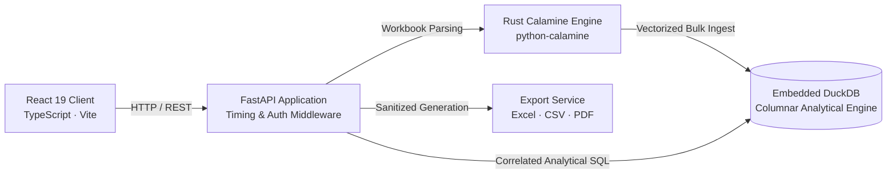

# EduQuery

Deterministic academic marksheet analysis and cohort verification engine.

[](https://www.python.org/)
[](https://fastapi.tiangolo.com)
[](https://duckdb.org/)
[](https://react.dev/)
[](https://www.typescriptlang.org/)
[](LICENSE)

[Overview](#overview) | [Features](#features) | [Architecture](#architecture) | [Benchmarks](#benchmarks) | [Quick Start](#quick-start) | [Testing](#testing) | [Documentation](#documentation)

---

## Overview

EduQuery parses, reconciles, and analyzes unstandardized university semester marksheets formatted as multi-tier merged Excel spreadsheets. It replaces fragile manual spreadsheet formulas with an embedded, vectorized analytical engine built on FastAPI and DuckDB.

The platform provides verified student performance breakdowns, curriculum-wide failure analytics, multi-condition cohort filtering, and multi-format reports while preserving cell-level provenance (`Source Sheet` and `Source Row`) back to original records.

---

## Features

### Fast Ingestion & Layout Parsing
- Parallel spreadsheet cell extraction powered by the `python-calamine` Rust extension.
- Vectorized bulk insertion into DuckDB tables (`students`, `courses`, `scores`, `grades`, `reconciliation`).
- Layout induction supporting multi-tier merged headers, single-row, and multi-sheet division formats.

### Deterministic Five-State Mark Semantics
Every cell is classified into one of five explicit states without silent truncation or arbitrary clamping:
- `marked`: Numeric score, with optional suffix flag (e.g. `45`, `32F`).
- `flagged`: Non-numeric status marker (e.g. `AB`, `ABS`).
- `uncalculated`: Explicit absent or placeholder indicator (`-`, `NA`).
- `not_enrolled`: Empty cell representing an elective un-offered to that student.
- `unparsed`: Malformed text surfaced directly for review.

### Elective Course Handling
- Supports Multidisciplinary Minor (MDM) elective groups where students take 1 of N offered subjects.
- Unselected elective alternatives generate no phantom records or false mismatch warnings.
- Course failure rates calculate strictly against enrolled student denominators.

### Cohort Investigation Engine
- Boolean filter builder (`AND` / `OR`) supporting criteria across divisions, failure counts, SGPI, total scores, and component marks.
- Correlated scalar subqueries with `COALESCE(..., 0)` ensure zero-backlog students (`failed_subject_count = 0`) are returned accurately.
- Hardened comma-delimited token matching (`(',' || flags || ',') LIKE '%,F,%'`) prevents false positives from non-failing strings such as `OFFLINE` or `FIRST_CLASS`.

### Verified Exports
- Exports to Excel (`.xlsx`), CSV, and PDF.
- Investigation exports include explicit source coordinates: `Source Sheet` (column N5) and `Source Row` (column O5).
- Auto-filters apply across the full data table (`A5:O{last_row}`).
- Neutralizes spreadsheet formula injection by escaping trigger characters (`=`, `+`, `-`, `@`, `\t`, `\r`) while preserving valid signed numbers.

---

## Architecture

EduQuery pairs a browser single-page application with a stateless backend and an in-memory columnar engine:



For detailed layer boundaries, database schemas, and concurrency models, see [`docs/architecture.md`](./docs/architecture.md).

---

## Benchmarks

Measurements conducted on local test hardware (Windows 11, Python 3.14.2, DuckDB 1.5.6, 1 warmup run + 3 measured runs):

| Workbook | Cohort Profile | File Size | Core Ingestion (`calamine` + DuckDB) | Full Pipeline (`create_temporary_session`) |
| :--- | :--- | :---: | :---: | :---: |
| `Result_anonymized.xlsx` | 145 Students, 27 Courses | 154.9 KiB | 740.30 ms | 868.24 ms |
| `test1_commerce_same_layout.xlsx` | 20 Students, 10 Courses | 20.4 KiB | 103.98 ms | 167.71 ms |
| `test1_same_layout_10courses_3divs.xlsx` | 20 Students, 10 Courses (3 Divs) | 20.3 KiB | 101.97 ms | 217.63 ms |
| `test2_lifesci_vague_single_row.xlsx` | 15 Students, 8 Courses | 12.9 KiB | 81.30 ms | 175.44 ms |
| `test3_messy_sheet_per_division.xlsx` | 18 Students, 9 Courses | 15.6 KiB | 89.94 ms | 186.11 ms |

- Frontend initial workspace mount: `< 100 ms`
- Warm session status check (`/session/status`): `15–25 ms`
- Total local HTTP round-trip (145-student cohort): `~837 ms`
- Render Free-tier cold start (when container is asleep): `50–70 s`

For full methodology and instrumentation details, see [`docs/production-performance-and-reliability.md`](./docs/production-performance-and-reliability.md).

---

## Quick Start

### Prerequisites
- Python 3.11+
- Node.js >= 18 and npm
- Git

---

### Local Development

#### 1. Backend

```bash
# Clone repository
git clone https://github.com/armash66/edu-query.git
cd edu-query

# Set up virtual environment
python -m venv .venv

# Windows (PowerShell):
.venv\Scripts\Activate.ps1
# Linux / macOS:
source .venv/bin/activate

# Install dependencies
pip install -r requirements.txt

# Run server
python -m uvicorn app.main:app --host 127.0.0.1 --port 8000 --reload
```

#### 2. Frontend

In a separate terminal:

```bash
cd frontend
npm install
npm run dev
```

App runs at `http://localhost:5173`. Interactive OpenAPI docs are at `http://127.0.0.1:8000/docs`.

---

### Docker

```bash
# Build multi-stage production image
docker build -t eduquery:latest .

# Run container
docker run -p 8000:8000 --rm eduquery:latest
```

---

## Testing

```bash
# Backend test suite (Pytest)
python -m pytest -q

# Frontend test suite (Vitest)
cd frontend
npm run test:run

# TypeScript verification
npm run build
```

---

## Documentation

Comprehensive engineering documents are located in the [`docs/`](./docs/) directory:

- [`docs/production-performance-and-reliability.md`](./docs/production-performance-and-reliability.md): Production performance engineering, session restoration, ingestion profiling, and SQL correctness.
- [`docs/architecture.md`](./docs/architecture.md): System boundaries, database concurrency, and layer design.
- [`docs/security.md`](./docs/security.md): Security gate, CORS allowlisting, and threat model.
- [`docs/data-handling.md`](./docs/data-handling.md): Marksheet parsing rules, five-state induction, and elective invariants.
- [`docs/investigation-engine.md`](./docs/investigation-engine.md): Query grammar, AST translation, and presets.
- [`docs/api-contract.md`](./docs/api-contract.md): REST API contracts and schema definitions.

---

## License

MIT License. See [LICENSE](LICENSE) for details.
