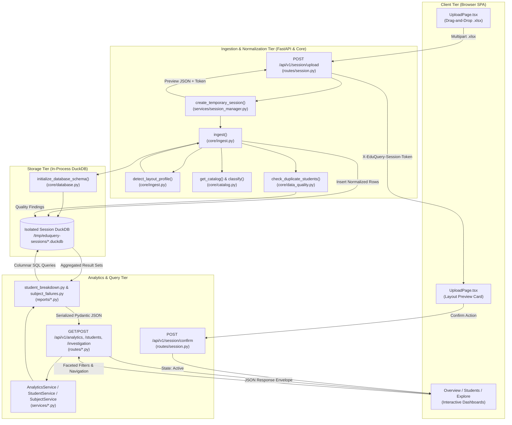
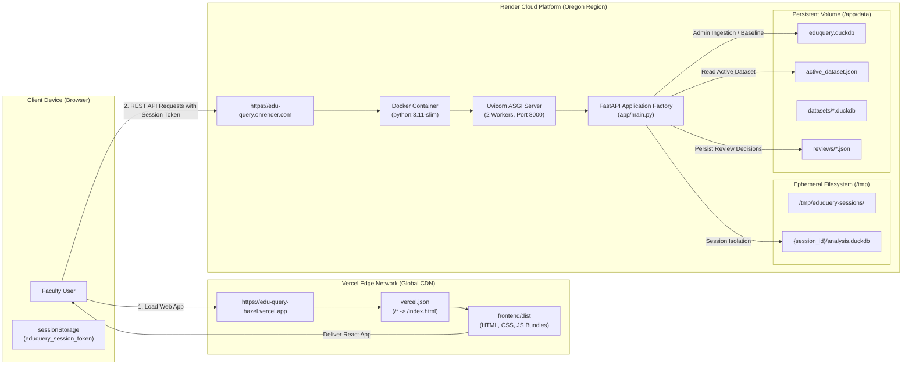

# EduQuery Project Audit: 03 - System Architecture & Pipeline

## 1. End-to-End Data Flow Pipeline

The EduQuery system processes academic marksheet data through a deterministic, ten-stage pipeline from workbook upload to interactive faculty presentation.

---

### Detailed Stage-by-Stage Breakdown

#### Stage 1: File Selection & Upload
- **Component:** [frontend/src/pages/UploadPage.tsx](file:///c:/Users/Armash%20Ansari/OneDrive/Desktop/Projects/AI%20&%20ML/eduquery-v3/frontend/src/pages/UploadPage.tsx)
- **Functions:** `handleFileSelect`, `handleDrop`, `uploadSession`
- **Action:** The faculty member drops an Excel marksheet (`.xlsx`). The client-side code verifies the MIME type and file extension (`.xlsx`), creates a `FormData` envelope, and dispatches an asynchronous HTTP POST request to `/api/v1/session/upload`.

#### Stage 2: Ingestion Staging & Session Provisioning
- **Component:** [app/api/routes/session.py](file:///c:/Users/Armash%20Ansari/OneDrive/Desktop/Projects/AI%20&%20ML/eduquery-v3/app/api/routes/session.py) and [app/services/session_manager.py](file:///c:/Users/Armash%20Ansari/OneDrive/Desktop/Projects/AI%20&%20ML/eduquery-v3/app/services/session_manager.py)
- **Functions:** `upload_temporary_marksheet()`, `create_temporary_session()`
- **Action:** Generates a secure session UUID (`session_id`). Allocates an isolated filesystem workspace in `/tmp/eduquery-sessions/{session_id}`. Enforces upload limits (`EDUQUERY_MAX_UPLOAD_SIZE_BYTES`, default: 25MB) and stream-writes the uploaded workbook to `source.xlsx`.

#### Stage 3: Automated Layout Induction
- **Component:** [app/core/ingest.py](file:///c:/Users/Armash%20Ansari/OneDrive/Desktop/Projects/AI%20&%20ML/eduquery-v3/app/core/ingest.py)
- **Functions:** `detect_layout_profile()`, `ingest()`
- **Action:** Reads the workbook using `openpyxl` with `data_only=False` (to preserve formula definitions) and `data_only=True` (to read cached evaluation results). Analyzes worksheet row structures:
  - Discovers table header coordinates and column anchors (`Seat No`, `Roll No`, `Name`, `Course Code`).
  - Detects student record stride: single-row layout vs paired-row layout (Row 1: metadata and component marks; Row 2: credits, course grades, grade points).
  - Discovers elective subjects across divisions.

#### Stage 4: Relational Table Normalization & DuckDB Population
- **Component:** [app/core/database.py](file:///c:/Users/Armash%20Ansari/OneDrive/Desktop/Projects/AI%20&%20ML/eduquery-v3/app/core/database.py) and [app/core/ingest.py](file:///c:/Users/Armash%20Ansari/OneDrive/Desktop/Projects/AI%20&%20ML/eduquery-v3/app/core/ingest.py)
- **Functions:** `initialize_database_schema()`, `extract_student_records()`
- **Action:** Initializes an in-process DuckDB database (`analysis.duckdb`). Creates the 8 core relational tables (`students`, `courses`, `enrollment`, `scores`, `grades`, `reconciliation`, `quality_findings`, `layout_profiles`). Streams parsed entities in batches:
  - Normalizes student identities (stripping leading/trailing whitespace, standardizing seat and roll numbers).
  - Unrolls sparse course marks into granular `scores` rows (recording component type: `IA`, `ESE`, `TW`, `PR`, `OR`, numeric value, raw text, and absent flags).
  - Records official course letter grades in `grades`.
  - Computes and records arithmetic component summations vs printed totals in `reconciliation`.

#### Stage 5: In-Process Data Quality Audit
- **Component:** [app/core/data_quality.py](file:///c:/Users/Armash%20Ansari/OneDrive/Desktop/Projects/AI%20&%20ML/eduquery-v3/app/core/data_quality.py)
- **Functions:** `check_duplicate_students()`, `check_mark_ranges()`, `check_formula_inconsistencies()`
- **Action:** Executes deterministic SQL integrity rules over the loaded DuckDB tables. Detects duplicate seat/roll numbers, orphaned score entries, out-of-range mark values ($<0$ or $>100$), and uncalculated formula cells. Writes findings to the `quality_findings` table.

#### Stage 6: Preview Synthesis & Session Token Issuance
- **Component:** [app/api/routes/session.py](file:///c:/Users/Armash%20Ansari/OneDrive/Desktop/Projects/AI%20&%20ML/eduquery-v3/app/api/routes/session.py)
- **Functions:** `upload_temporary_marksheet()`
- **Action:** Returns an HTTP 200 payload containing the detected layout profile, student count, course count, sample preview rows, and blocking error status (`can_confirm`). Sets the `eduquery_session` HTTP-only cookie and injects `X-EduQuery-Session-Token` into response headers.

#### Stage 7: Client Review & Confirmation
- **Component:** [frontend/src/pages/UploadPage.tsx](file:///c:/Users/Armash%20Ansari/OneDrive/Desktop/Projects/AI%20&%20ML/eduquery-v3/frontend/src/pages/UploadPage.tsx)
- **Functions:** `handleConfirmSession()`
- **Action:** The faculty member reviews the detected layout card. If `can_confirm` is true, clicking "Confirm & Open Analysis" sends a POST request to `/api/v1/session/confirm`. The backend marks the session state as `active`. The frontend stores the session token in `sessionStorage` and redirects to `/` (Overview Page).

#### Stage 8: Analytical Query Dispatch
- **Component:** [frontend/src/api/client.ts](file:///c:/Users/Armash%20Ansari/OneDrive/Desktop/Projects/AI%20&%20ML/eduquery-v3/frontend/src/api/client.ts)
- **Functions:** `getAnalyticsOverview()`, `getStudents()`, `queryInvestigation()`
- **Action:** As faculty navigate pages, the client dispatches requests to `/api/v1/analytics/overview`, `/api/v1/students`, `/api/v1/absent-students`, `/api/v1/subjects`, or `/api/v1/investigation/query`. Each request attaches `X-EduQuery-Session-Token`.

#### Stage 9: In-Process Analytical Execution
- **Component:** [app/services/analytics_service.py](file:///c:/Users/Armash%20Ansari/OneDrive/Desktop/Projects/AI%20&%20ML/eduquery-v3/app/services/analytics_service.py), [app/reports/student_breakdown.py](file:///c:/Users/Armash%20Ansari/OneDrive/Desktop/Projects/AI%20&%20ML/eduquery-v3/app/reports/student_breakdown.py), [app/services/investigation_service.py](file:///c:/Users/Armash%20Ansari/OneDrive/Desktop/Projects/AI%20&%20ML/eduquery-v3/app/services/investigation_service.py)
- **Functions:** `get_analytics_overview()`, `get_student_breakdown()`, `query_investigation()`
- **Action:** Resolves the session DuckDB database via [app/api/dependencies.py](file:///c:/Users/Armash%20Ansari/OneDrive/Desktop/Projects/AI%20&%20ML/eduquery-v3/app/api/dependencies.py). Executes analytical SQL queries directly against columnar storage in memory/disk. Aggregations, percentiles, division groupings, and predicate filters execute in sub-30ms execution times.

#### Stage 10: JSON Serialization & Interactive Visualization
- **Component:** Frontend Views ([OverviewPage.tsx](file:///c:/Users/Armash%20Ansari/OneDrive/Desktop/Projects/AI%20&%20ML/eduquery-v3/frontend/src/pages/OverviewPage.tsx), [StudentsPage.tsx](file:///c:/Users/Armash%20Ansari/OneDrive/Desktop/Projects/AI%20&%20ML/eduquery-v3/frontend/src/pages/StudentsPage.tsx), [ExplorePage.tsx](file:///c:/Users/Armash%20Ansari/OneDrive/Desktop/Projects/AI%20&%20ML/eduquery-v3/frontend/src/pages/ExplorePage.tsx))
- **Action:** Pydantic models validate and serialize the result set into JSON. The React views consume the typed response, updating metric cards, outcome donut charts, division comparisons, interactive paginated data tables, and print marksheet views.

---

## 2. Deployment Architecture & Cloud Topography

---

## 3. State Storage Breakdown

EduQuery carefully isolates different categories of state across database files, JSON metadata, memory, and client storage:

| Storage Domain | Storage Mechanism | Location / Key | Purpose & Contents | Lifecycle & Retention |
| :--- | :--- | :--- | :--- | :--- |
| **Persistent Relational State** | DuckDB database files | `/app/data/eduquery.duckdb` and `/app/data/datasets/*.duckdb` | Persistent master dataset containing normalized tables (`students`, `courses`, `scores`, `grades`, `reconciliation`, `quality_findings`). | Retained across container restarts if mounted to persistent volume; versioned upon administrative confirmation. |
| **Temporary Session Relational State** | Ephemeral DuckDB database files | `/tmp/eduquery-sessions/{session_id}/analysis.duckdb` | Isolated columnar database created per uploaded workbook for privacy-first faculty analysis. | Automatically pruned after TTL expiration (`EDUQUERY_IMPORT_SESSION_TTL_SECONDS`, default 3600s) or upon explicit user deletion. |
| **Active Dataset Pointer** | JSON file | `/app/data/active_dataset.json` | Atomic reference referencing the currently active dataset ID, database file path, activation timestamp, and record counts. | Updated atomically via temporary file replacement (`os.replace`) upon dataset activation or rollback. |
| **Faculty Review Decisions** | JSON files | `/app/data/reviews/{dataset_id}_reviews.json` | Persisted faculty decisions on detected anomalies (marking an anomaly as `verified_correct` or `needs_investigation`). | Persisted indefinitely alongside dataset versions. |
| **Backend In-Memory State** | Python process memory | `app.core.database._connection_cache` | Cached open DuckDB connection handles and threading locks to prevent file-locking conflicts. | Cleared upon process termination or container restart. |
| **Browser Client Session State** | Browser `sessionStorage` | `sessionStorage.getItem('eduquery_session_token')` | Stores active temporary session UUID for the current tab. | Cleared when browser tab is closed or when faculty clicks "Delete Session". |
| **Browser Authentication Cookie** | HTTP Cookie | `eduquery_session` | HTTP-only, SameSite=Lax cookie reflecting the active session token. | Expires based on TTL (1 hour); used as fallback if header is absent. |
| **Administrative Credentials** | React context (In-memory) | `AdminKeyContext` | Holds the administrative API key entered by the user in the admin modal. | Stored in memory only; never written to localStorage or cookies. |

---

## 4. Per-Request Rebuild & Caching Analysis

### What is NEVER rebuilt per request:
1. **Spreadsheet Ingestion & Layout Parsing:** Excel decoding (`openpyxl`) and layout induction occur **only once** when a file is uploaded to `/upload`. The resulting normalized data is committed to the session's DuckDB database. No analytical request (viewing students, course failures, GPA distributions, or running ad-hoc queries) ever re-reads or re-parses the Excel workbook.
2. **Database Schema Creation:** DDL execution (`CREATE TABLE`, indexing) occurs exclusively during ingestion. Read queries operate on existing tables.
3. **Database Connection Initialization:** DuckDB read-only connection handles are cached and reused across concurrent requests via `app.core.database._connection_cache`, eliminating connection establishment overhead.

### What executes per request:
1. **Columnar SQL Query Execution:** Each page view or filter adjustment issues parameterized SQL queries to DuckDB (e.g., `SELECT * FROM students WHERE ... LIMIT 50`). DuckDB executes these queries directly in memory/vectorized disk cache in $<30\text{ ms}$.
2. **Anomaly Classification & Review Merging:** When `/api/v1/anomaly/list` is queried, deterministic rules and robust statistical calculations run over the DuckDB scores, and persisted review statuses from `reviews/{dataset_id}_reviews.json` are joined in memory.
3. **Pydantic Validation & JSON Serialization:** FastAPI validates query parameters and serializes DuckDB result tuples into typed Pydantic response envelopes before transmitting HTTP responses.

