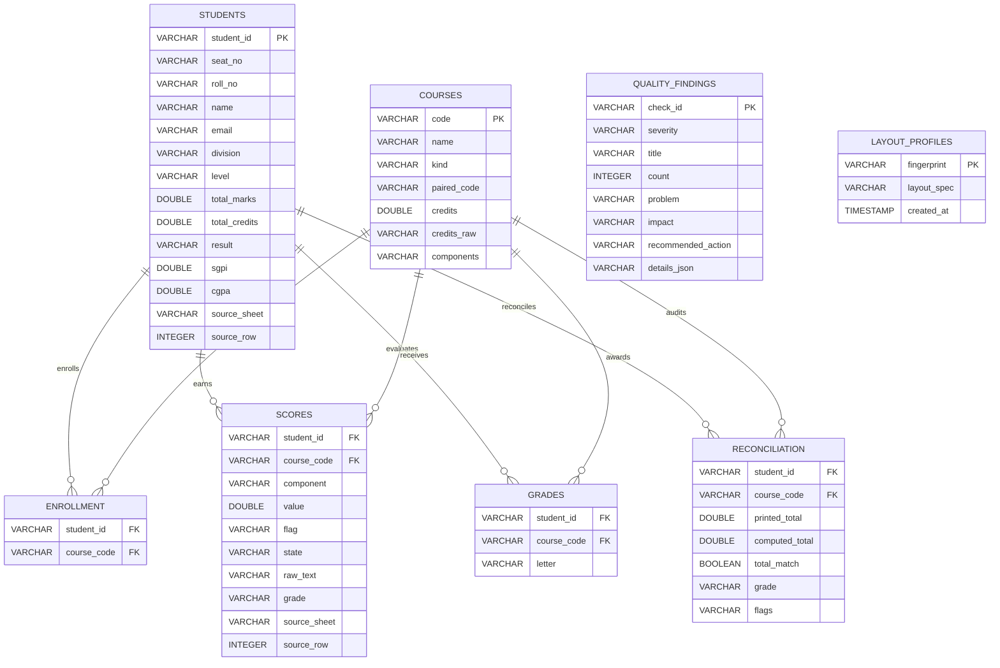

# EduQuery Project Audit: 08 - Data, Schema & Query Capabilities

## 1. Database Schema Specification (In-Process DuckDB)

The core database engine is an embedded DuckDB columnar database containing 8 relational tables:



---

### Detailed Table Definitions

#### 1. `students` (Student Master Table)
Holds demographic, academic identity, and semester-level summary totals.
- `student_id` (`VARCHAR`): Normalized internal identifier (e.g., `23108A0004`).
- `seat_no` (`VARCHAR`): Examination seat number as printed on admit cards.
- `roll_no` (`VARCHAR`): Institutional class roll number.
- `name` (`VARCHAR`): Normalized candidate name (uppercase, standardized spacing).
- `email` (`VARCHAR`): Student email if present in workbook.
- `division` (`VARCHAR`): Academic cohort division partition (e.g., `"A"`, `"B"`, `"C"`).
- `level` (`VARCHAR`): Program level (e.g., `"UG"`, `"PG"`).
- `total_marks` (`DOUBLE`): Cumulative marks earned across all enrolled semester courses.
- `total_credits` (`DOUBLE`): Total credits earned by the student.
- `result` (`VARCHAR`): Official recorded semester outcome (`"PASSES"`, `"FAILS"`, `"PROMOTED"`).
- `sgpi` (`DOUBLE`): Semester Grade Performance Index (Scale 0.0 to 10.0).
- `cgpa` (`DOUBLE`): Cumulative Grade Point Average.
- `source_sheet` (`VARCHAR`), `source_row` (`INTEGER`): Audit provenance tracking row origin in spreadsheet.

#### 2. `courses` (Curriculum Subject Master)
Catalog of all academic courses discovered during layout induction.
- `code` (`VARCHAR`): Course code (e.g., `"PCEC12T"`, `"MDM01"`).
- `name` (`VARCHAR`): Official descriptive course name.
- `kind` (`VARCHAR`): Course category (`"theory"`, `"practical"`, `"elective"`).
- `paired_code` (`VARCHAR`): Code of associated practical/tutorial course if linked.
- `credits` (`DOUBLE`): Academic credit weighting.
- `components` (`VARCHAR`): Comma-separated list of evaluated components (`"IA,ESE"`).

#### 3. `enrollment` (Student-to-Course Mapping)
Explicit enrollment mapping accounting for elective choices.
- `student_id` (`VARCHAR`), `course_code` (`VARCHAR`): Composite link.

#### 4. `scores` (Granular Component Marks)
Individual assessment evaluation records.
- `student_id` (`VARCHAR`), `course_code` (`VARCHAR`): Foreign links.
- `component` (`VARCHAR`): Evaluation component (`"IA"`, `"ESE"`, `"TW"`, `"PR"`, `"OR"`).
- `value` (`DOUBLE`): Numeric score earned ($0.0 \le \text{value} \le \text{max}$).
- `flag` (`VARCHAR`): Assessment markers (`"AB"` for absent, `"EX"` for exempt).
- `state` (`VARCHAR`): Component evaluation state (`"valid"`, `"absent"`, `"missing"`).
- `raw_text` (`VARCHAR`): Exact literal string from Excel cell before coercion.

#### 5. `grades` (Official Course Letter Grades)
Final letter grade assigned per student per course.
- `student_id` (`VARCHAR`), `course_code` (`VARCHAR`), `letter` (`VARCHAR`): Letter grade (`"O"`, `"A"`, `"B"`, `"C"`, `"D"`, `"E"`, `"P"`, `"F"`).

#### 6. `reconciliation` (Arithmetic Integrity Verification)
Reconciles printed totals in administrative records against computed component sums.
- `student_id` (`VARCHAR`), `course_code` (`VARCHAR`): Foreign links.
- `printed_total` (`DOUBLE`): Total marks printed in official record.
- `computed_total` (`DOUBLE`): Sum of all components ($\sum \text{scores.value}$).
- `total_match` (`BOOLEAN`): `true` if $|\text{printed} - \text{computed}| < 0.05$; `false` if arithmetic discrepancy exists.
- `flags` (`VARCHAR`): Discrepancy classification tags (`"ARITHMETIC_MISMATCH"`, `"FLAG_OVERRIDE"`).

#### 7. `quality_findings` (Automated Audit Findings)
Stores detected anomalies, missing data, and formula issues.
- `check_id` (`VARCHAR`), `severity` (`"critical"`, `"warning"`, `"info"`), `title` (`VARCHAR`), `count` (`INTEGER`), `problem` (`VARCHAR`), `impact` (`VARCHAR`), `recommended_action` (`VARCHAR`), `details_json` (`VARCHAR`).

---

## 2. Typed Query Plan Schema (`InvestigationQueryRequest`)

The ad-hoc investigation engine translates a typed JSON predicate tree into safe parameterized DuckDB SQL queries:

### JSON Schema Specification
```json
{
  "type": "object",
  "properties": {
    "conditions": {
      "type": "array",
      "items": {
        "type": "object",
        "required": ["field", "operator", "value"],
        "properties": {
          "field": {
            "type": "string",
            "enum": ["division", "status", "result", "total_marks", "sgpi", "failed_count", "course_code"]
          },
          "operator": {
            "type": "string",
            "enum": ["eq", "neq", "gt", "gte", "lt", "lte", "contains", "in"]
          },
          "value": {
            "type": ["string", "number", "boolean", "array"]
          }
        }
      }
    },
    "combinator": {
      "type": "string",
      "enum": ["and", "or"],
      "default": "and"
    },
    "limit": {
      "type": "integer",
      "default": 50,
      "maximum": 100
    },
    "offset": {
      "type": "integer",
      "default": 0
    },
    "sort_by": {
      "type": "string",
      "default": "total_marks"
    },
    "sort_order": {
      "type": "string",
      "enum": ["asc", "desc"],
      "default": "desc"
    }
  }
}
```

---

## 3. Supported Question Types & Faculty Intents

| Intent / Category | Description | Example Faculty Question 1 | Example Faculty Question 2 |
| :--- | :--- | :--- | :--- |
| **1. Student Marksheet Transcript** | Full component breakdown for an individual student. | *"Show the complete marksheet for student 23108A0004 with component marks."* | *"What did student with Seat No 1015 score in Internal vs Theory for Communication Systems?"* |
| **2. Subject Failure Analysis** | Curriculum-level pass/fail distributions and failure rankings. | *"Which subject has the highest failure rate across Division A and Division B?"* | *"List all students who failed course PCEC12T along with their component scores."* |
| **3. Absenteeism Auditing** | Classwide tracking of missing, absent, or exempted exam markers. | *"Generate a roster of all students marked absent (AB) in Mid-Semester Exams."* | *"How many students were absent in Division B practical sessions for Computer Networks?"* |
| **4. Division Benchmarking** | Comparative analytics between divisions or cohort sections. | *"Compare the passing percentage and class average between Division A and Division B."* | *"What is the score distribution histogram across the entire second-year cohort?"* |
| **5. Data Integrity & Reconciliation** | Audit discrepancies between printed mark totals and component summations. | *"Are there any students whose printed total does not match the sum of IA + ESE marks?"* | *"Identify any duplicate seat numbers or marks exceeding the maximum of 100."* |
| **6. Ad-Hoc Faceted Filtering** | Multi-attribute boolean queries across academic parameters. | *"Find all students in Division A who scored >600 marks but failed 1 subject."* | *"Filter students who have an SGPI < 6.0 and 2 or more failed subjects."* |

---

## 4. Known Limitations & Unsupported Question Types

1. **Free-Form Conversational Natural Language (LLM Chat):**
   - *Limitation:* EduQuery deliberately does not include a natural language chat interface or LLM-based text-to-SQL generation.
   - *Rationale:* As documented in `docs/product-reorientation.md`, LLM text-to-SQL generates hallucinations and arithmetic miscalculations when aggregating marks, which is unacceptable for academic records.
2. **Cross-Semester Multi-Year Longitudinal Progression:**
   - *Limitation:* The system is designed to ingest and analyze one semester marksheet workbook at a time. It cannot currently track a single student's CGPA trajectory across Semesters 1 through 8.
3. **Scanned PDF & Image OCR:**
   - *Limitation:* Ingestion requires digital `.xlsx` spreadsheets; it does not perform optical character recognition (OCR) on scanned physical marksheets.
4. **Institutional Rule Customization via UI:**
   - *Limitation:* Passing cutoffs (40% rule, internal minimums) are currently defined in configuration code rather than configurable via a faculty settings UI.

---

## 5. Input Workbook Layout (Anonymized Synthetic Representation)

Typical higher education marksheets ingested by EduQuery feature a dense **paired-row stride** structure where each student occupies two stacked rows:

```
+---------------------------------------------------------------------------------------------------------------------------------------------------------------------------------------+
| S.N. | SEAT NO | CANDIDATE NAME                     | ROLL NO | DIV | COURSE 1 (PCEC12T)       | COURSE 2 (PCEC13T)       | COURSE 3 (MDM01)         | TOTAL | SGPI | RESULT   |
|      |         |                                    |         |     | IA (20) | ESE (80) | TOT | IA (20) | ESE (80) | TOT | IA (20) | ESE (80) | TOT |       |      |          |
+---------------------------------------------------------------------------------------------------------------------------------------------------------------------------------------+
| 1    | 1001    | [SYNTHETIC_CANDIDATE_NAME_ALPHA]   | 23101   | A   | 18      | 62       | 80  | 16      | 58       | 74  | 19      | 68       | 87  | 612   | 8.42 | PASSES   |
|      |         |                                    |         |     | C: 4.0  | G: A     | 32  | C: 4.0  | G: B     | 28  | C: 3.0  | G: O     | 30  | 24 CR |      |          |
+---------------------------------------------------------------------------------------------------------------------------------------------------------------------------------------+
| 2    | 1002    | [SYNTHETIC_CANDIDATE_NAME_BETA]    | 23102   | A   | 11      | 24       | 35  | 14      | 46       | 60  | AB      | 50       | 50  | 480   | 5.80 | FAILS    |
|      |         |                                    |         |     | C: 4.0  | G: F     | 0   | C: 4.0  | G: C     | 20  | C: 3.0  | G: F     | 0   | 17 CR |      | (KT: 2)  |
+---------------------------------------------------------------------------------------------------------------------------------------------------------------------------------------+
```

### Layout Invariants Discovered by Ingestion Engine:
1. **Row 1 (Metadata & Marks):** Holds Student Identity (Seat, Roll, Name, Division), Component Scores (`IA`, `ESE`), Printed Course Totals, and Semester Total Marks.
2. **Row 2 (Academic Credits & Grades):** Holds Component Credits ($C$), Letter Grades ($G$), Grade Points ($C \times G$), Total Earned Credits ($24\text{ CR}$), Semester SGPI, and Final Result Status.
3. **Elective Subject Alignment:** In Course 3 above, some students take `MDM01` while others in the same division take `MDMBD02`. The parser detects sparse column headers and maps enrollment accurately.

