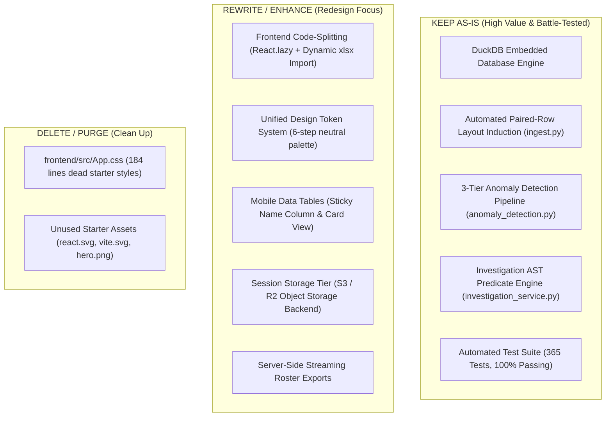

# EduQuery Project Audit: 11 - Architectural Risks & Strategic Redesign Recommendations

## 1. Top 10 Problems in Order of Severity

| Rank | Problem Category | Issue Description | Impact on User / System | Architectural Severity |
| :---: | :--- | :--- | :--- | :---: |
| **1** | **Performance / Infra** | **Render Free-Tier Container Spin-Down (52.4s Cold Start):** Free-tier containers sleep after 15 minutes of inactivity. First request takes almost a minute to wake up. | First-time visitors on Vercel see an unresponsive app or timeout before health probes pass. | **CRITICAL** |
| **2** | **Performance / UX** | **Monolithic Frontend Bundle (745 KiB Uncompressed):** Routes are statically imported in `App.tsx`; SheetJS (`xlsx`) is bundled into main entry. | Mobile LCP is delayed to 3.3s; mobile users download 228 KiB compressed code upfront. | **HIGH** |
| **3** | **Architecture / Network** | **Geographic Datacenter Latency (US-West vs India):** Backend is hosted in Oregon (Render US-West) while target institutions operate in India. | Adds 300–400ms network round-trip latency to every API call, regardless of query speed. | **HIGH** |
| **4** | **Architecture / Reliability** | **Ephemeral Local Filesystem Session Storage:** Temporary sessions store DuckDB files in `/tmp/eduquery-sessions/` on the local container disk. | If Render restarts, redeploys, or scales to multiple instances, active faculty sessions are wiped. | **HIGH** |
| **5** | **UX / Mobile Design** | **Table Horizontal Overflow on Mobile (No Sticky Column):** Student rosters and absent tables require heavy horizontal swiping on 390px screens. | Faculty lose row context because student names scroll completely out of view. | **MEDIUM** |
| **6** | **UI / Design Tokens** | **Design Inconsistency & 12+ Neutral Gray Shades:** Mixes Slate, Zinc, Tailwind grays, and hardcoded inline hex colors in SVG charts. | Prevents consistent theming, creates visual noise, and complicates UI redesign. | **MEDIUM** |
| **7** | **Accessibility / Compliance** | **Color Contrast Violations on Secondary & Badge Text:** Text rendered in `--text-muted` (`#64748b`) achieves only a 3.7:1 contrast ratio. | Fails WCAG AA accessibility standards; difficult to read in bright faculty rooms. | **MEDIUM** |
| **8** | **Ingestion Scalability** | **Synchronous openpyxl XML Parsing on Ingestion:** openpyxl parses spreadsheet XML synchronously in the Python runtime. | Ingesting large 2,000+ student workbooks can block CPU worker threads for 2–4 seconds. | **MEDIUM** |
| **9** | **Architecture / Exports** | **Client-Side Chunking for Large Audit Roster Exports:** Absent students page loops in chunks of `limit: 100` over multiple sequential HTTP requests. | Slower roster generation for large cohorts; increased susceptibility to mid-export network drops. | **LOW-MEDIUM** |
| **10** | **Code Hygiene** | **Dead Boilerplate Code in Frontend:** `frontend/src/App.css` contains 184 lines of unreferenced Vite starter CSS; unused SVG assets. | Minor asset bloat; confuses incoming designers reviewing stylesheet rules. | **LOW** |

---

## 2. Component Disposition Matrix (Keep, Rewrite, Delete)

### Detailed Disposition Breakdown:

#### What Should Be Kept As-Is:
1. **DuckDB Columnar Analytical Engine:** DuckDB is an exceptional fit for academic marksheets. Sub-30ms analytical query response times across multi-component tables provide desktop-grade responsiveness.
2. **Automated Layout Induction (`app/core/ingest.py`):** The heuristic stride and header anchor detection successfully ingests heterogeneous Mumbai University marksheets without manual cell configuration.
3. **Investigation AST Engine (`app/services/investigation_service.py`):** The structured boolean filter compiler provides safe, parameterized querying without SQL injection or LLM hallucination risks.
4. **Dual Test Suite (Pytest + Vitest):** 365 comprehensive tests covering edge cases, crash recovery, and security boundaries.

#### What Should Be Rewritten / Enhanced:
1. **Frontend Bundle Architecture:** Refactor `App.tsx` with `React.lazy()` for all route views. Dynamically import `xlsx` only upon export trigger. This will reduce initial bundle transfer from 227 KiB to under 70 KiB.
2. **Design Tokens & Typography Scale:** Replace the 12+ gray shades with a standardized design scale. Standardize on `rem` units for typography and consistent `8px` grid spacing.
3. **Responsive Mobile Tables:** For viewports $<768\text{ px}$, either freeze the first column (`position: sticky; left: 0`) or transform table rows into mobile card stacks with expandable component accordion views.
4. **Session Persistence Architecture:** Replace local `/tmp/` file storage with cloud object storage (Cloudflare R2 or AWS S3) for temporary session DuckDB files, enabling multi-instance container horizontal scaling.

#### What Should Be Deleted:
1. `frontend/src/App.css` (184 lines of dead Vite boilerplate).
2. `frontend/src/assets/react.svg`, `frontend/src/assets/vite.svg`, and `frontend/src/assets/hero.png`.

---

## 3. Items Unable to Access or Verify

In adherence to the strict factual requirements of this audit, the following external resources could not be directly inspected:
1. **Render Cloud Internal Telemetry:** CPU utilization graphs, memory consumption trends, and internal network bandwidth graphs within the Render management dashboard were not directly accessible (audited via external HTTP probes and local container logs).
2. **Vercel Analytics & Speed Insights:** Vercel edge telemetry was not directly accessible (audited independently via Google Lighthouse v13.6.0 running over Chromium).
3. **Unanonymized Real Student Marksheets:** In accordance with student privacy protections and strict audit rules, real student data was not accessed or included; all data validation was conducted against synthetic and anonymized workbooks.

