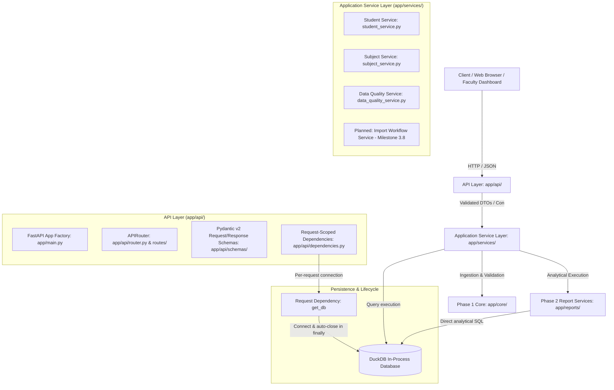

# EduQuery V3 — System Architecture Specification

## 1. System Goals and Non-Goals

### Goals
- **Deterministic Marksheet Analysis**: Ingest wide, complex college marksheet workbooks (including multi-tier merged headers, disparate division layouts, and inconsistent grading schemes) into an analytical relational schema.
- **Traceable Academic Outcomes**: Provide exact, provable answers to primary faculty questions:
  1. *Student-level breakdown*: Exactly which subjects a student passed, failed, or has unresolved, reconciled with printed marksheet totals.
  2. *Subject-level failure listings*: Comprehensive roster of students failing any given course, with component-level scores and division filtering.
  3. *Data quality assurance*: Immediate identification of anomalies (duplicate student IDs, sum mismatches, out-of-range marks).
- **High-Performance Vectorized Querying**: Leverage DuckDB for in-process SQL execution, achieving sub-10ms response times without external database services.
- **Strict Separation of Concerns**: Isolate HTTP parsing, application workflows, academic domain invariants, and data access.

### Explicit Non-Goals
- **No Large Language Models (LLMs)**: Zero chatbot functionality, neural query planners, LoRA fine-tuning, or generative text. Faculty require deterministic, auditable numbers, not probabilistic approximations.
- **No Universal Passing Threshold**: Academic passing policies vary across universities, courses, and component types (e.g., separate passing on theory ESE vs combined total). The system must never enforce an arbitrary numeric threshold (e.g. `marks >= 40`).
- **No Data Fabrication**: Blank, zero (`0.0`), absent (`AB`), and uncalculated values must remain distinctly represented and never converted into speculative pass/fail outcomes.
- **No Direct Academic Logic in HTTP Controllers**: Route handlers must never evaluate pass/fail criteria or query DuckDB directly.

---

## 2. Preserved System Core (Phases 1 and 2)

Phase 3 is an evolutionary architectural layer built directly on top of the validated Phase 1 and Phase 2 implementations. The following modules are strictly preserved and remain the single source of truth for analytical correctness:

```
Phase 1 Core (app/core/):
  ├── catalog.py       # Multi-sheet layout classification & fingerprinting
  ├── ingest.py        # Multi-tier layout induction, cell normalization, DuckDB loading
  ├── models.py        # Strongly typed domain dataclasses (Student, Course, Score, etc.)
  ├── database.py      # Relational DDL (8 tables), bulk populator, connection helper
  └── data_quality.py  # 7-point marksheet integrity and anomaly audit

Phase 2 Engines (app/reports/):
  ├── student_breakdown.py  # resolve_student (wildcard-hardened) & get_student_breakdown
  └── subject_failures.py   # resolve_course, get_subject_failures, list_all_subjects_failure_summary
```

### Relational Schema (8 Core Tables)
1. `students`: Demographics, seat numbers, roll numbers, division, overall result, SGPI/CGPA, workbook provenance.
2. `courses`: Course code, full title, kind (`theory` vs `practical`), credits, component structure.
3. `scores`: Atomized component marks (e.g. `TH`, `IA`, `PR`, `OR`), flags, states (`marked`, `not_enrolled`, `uncalculated`, `flagged`, `unparsed`), raw text.
4. `grades`: Course-level letter grades (`O`, `A`, `F`, etc.).
5. `enrollment`: Explicit `(student_id, course_code)` pairs defining verified cohort membership.
6. `reconciliation`: Comparison of computed component sums against printed totals, recording discrepancies and flags.
7. `layout_profiles`: Structural fingerprints and layout specifications per sheet.
8. `quality_findings`: Audit findings categorized by severity (`error`, `warning`, `info`).

---

## 3. Implemented Phase 3.2 Architecture & Layer Boundaries



### Layer Responsibility Matrix

| Layer | Module Path | Status | Primary Responsibility | Forbidden Behaviors |
| :--- | :--- | :--- | :--- | :--- |
| **API Layer** | `app/api/` | **Implemented** | HTTP routing, parameter parsing, status codes, Pydantic validation, error envelopes, global exception handling. | No direct SQL queries; no pass/fail evaluation; no raw DuckDB row serialization. |
| **Service Layer** | `app/services/` | **Implemented** | Use-case orchestration, pagination/sorting slicing, DTO mapping. | No HTTP request/response object handling; no marksheet layout parsing. |
| **Report Engines** | `app/reports/` | **Implemented** (Phase 2) | Academic classification, candidate resolution, cohort reconciliation. | No HTTP awareness; no hardcoded pass thresholds. |
| **Persistence / Dependency** | `app/api/dependencies.py` | **Implemented** | Request-scoped connection lifecycle (`get_db`) with automatic connection closing and 503 unavailability signaling. | No connection leakage across requests; no unhandled lock retention. |
| **Repository Layer** | `app/repositories/` | *Planned (Phase 3.4+)* | Dedicated persistence boundary if persistence logic expands beyond current service queries. | No academic business rules; no query string interpolation. |
| **Ingestion Core** | `app/core/` | **Implemented** (Phase 1) | Excel layout induction, sheet cataloging, cell token parsing, provenance tracking. | No assumptions of clean data; no data modification without tracking. |

---

## 4. Database Lifecycle & Concurrency Strategy

### DuckDB Concurrency Invariants
- DuckDB supports **multiple concurrent read connections** against a database file (in read-only mode).
- DuckDB supports **exactly ONE write connection** at any given moment.
- In-memory databases (`:memory:`) cannot be shared across separate connections unless created via cursors from a single master connection.

### Implemented Lifecycle & Hardening (Phase 3.3)
1. **Per-Request Read-Only Connection Lifecycle (`app/api/dependencies.py`)**:
   - For read requests, `get_db(request)` resolves application settings via `request.app.state.settings`.
   - Opens an independent DuckDB connection to the configured database file with `read_only=True`.
   - Validates that required tables (`students`, `courses`) exist via `SHOW TABLES`. If tables are absent or the database is uninitialized, the connection is closed immediately and `DatabaseUnavailableError` is raised (mapped to `503 Service Unavailable`).
   - Yields the connection to the route handler and service layer.
   - A `finally:` block guarantees `con.close()` is executed immediately when the request concludes, preventing handle accumulation or file descriptor exhaustion even upon unhandled exceptions.
2. **Concurrency Invariants & Measured Behavior**:
   - DuckDB natively supports multiple concurrent read-only connections against the same database file across threads and processes without lock contention.
   - Independent per-request connections eliminate cross-thread buffer clobbering that occurs when sharing a single raw connection across threads.
   - Measured benchmark (Windows x86_64, CPython 3.14.2, 10 concurrent workers, 100 requests across all core endpoints):
     - 100% success rate (100/100 HTTP 200, 0 failures).
     - Total duration: 0.52s (~191 requests/second).
     - Latency: min 14.3ms, median (p50) 27.0ms, p95 140.0ms, max 166.4ms.
3. **Test Mode Isolation & Overrides**:
   - In-memory databases (`:memory:`) are isolated per test fixture.
   - FastAPI `app.dependency_overrides[get_db] = lambda: con` provides completely isolated, deterministic databases for each test without touching local files or acceptance workbooks.
4. **Implemented Import Architecture (Milestone 3.4 — Candidate Isolation & Atomic Pointer Activation)**:
   - **Isolated Candidate Staging**: Uploaded workbooks are streamed into quarantined storage (`data/imports/uploads/upload_<uuid>.xlsx`) with strict 25 MiB bounding and OpenXML magic byte checks (`PK\x03\x04` and `[Content_Types].xml`). They are ingested into an isolated candidate DuckDB database (`data/imports/candidates/candidate_<uuid>.duckdb`) without mutating or touching the active production database.
   - **Safe Privacy-Preserving Preview**: The preview endpoint (`POST /api/v1/imports/preview`) generates high-level counts, multi-sheet layout discoveries, and data-quality findings while strictly omitting student names, roll numbers, seat numbers, or marks. The response explicitly states `active_dataset_changed: false`.
   - **Persistent Session State Machine**: Sessions transition deterministically through `uploaded` -> `validating` -> `preview_ready` (or `validation_failed`) -> `confirmed` -> `activated` (or `expired` / `failed`). Session metadata is persisted as JSON (`data/imports/sessions/<uuid>.json`) so preview sessions survive application restarts.
   - **Controlled Versioned Promotion**: On confirmation (`POST /api/v1/imports/confirm`), the candidate database is revalidated (schema tables, non-zero students) and promoted to persistent versioned storage (`data/datasets/dataset_<timestamp>_<uuid>.duckdb`).
   - **Atomic Pointer Hot-Swap**: An authoritative pointer file (`data/active_dataset.json`) is atomically updated via a temporary file and `os.replace`. Runtime application state (`app.state.active_database_path`) is updated immediately.
   - **Windows File Lock Invariant & Concurrency Safety**: Windows locks DuckDB database files if any read-only connection is open (`WinError 32: process cannot access the file`). Because new datasets are assigned unique versioned filenames, active readers finish their queries against the previous database without interruption. Subsequent requests seamlessly bind to the new dataset.
   - **Server Restart Recovery & Containment**: On startup, `create_app()` inspects `data/active_dataset.json`, enforces strict filesystem containment (the target database file must reside inside `data/datasets/`), verifies required table schemas (`students`, `courses`), and verifies non-zero student records. If the pointer references a missing, corrupted, external, or empty database, startup cleanly falls back to the default configured dataset with warning logs, guaranteeing the application never crashes or activates an incomplete dataset.
   - **Power-Loss Durability & Fsync**: Pointer updates execute explicit `flush()` and `os.fsync(fileno)` on the temporary pointer file prior to `os.replace`, guaranteeing power-loss durability beyond OS dirty page writeback buffers.
   - **Cross-Process Concurrency & Mutex**: While in-process requests use `asyncio.Lock`, multi-worker or multi-process deployments (e.g., Gunicorn/Uvicorn multi-worker setups) are protected by a file-based mutual exclusion lock (`CrossProcessLock` via atomic `os.open` with `O_CREAT | O_EXCL`). This serializes candidate promotions across processes and prevents split-brain pointer updates.
   - **Single-Process vs Multi-Process Operating Model**: The application supports multiple concurrent read requests across processes without lock contention. Write/activation operations are strictly serialized across processes via `CrossProcessLock`. Concurrent write attempts to activate datasets will safely wait or timeout, preventing partial promotion or race conditions with storage cleanup.
   - **Ephemeral Candidate Retention & Cleanup**: Quarantine uploads and candidate staging databases remain isolated. The cleanup worker (`cleanup_import_storage`) purges expired sessions and orphaned candidate files, while acquiring the cross-process lock and strictly safeguarding the active dataset.
   - **Zero-Information Leakage Safeguard**: Import responses and session status endpoints (`GET /api/v1/imports/{import_id}`) are sanitized to strip internal server filesystem paths (`upload_path`, `candidate_db_path`), raw Python exception stack traces, and database connection strings. Session identifiers are validated against `^[a-zA-Z0-9_\-]{8,64}$`, completely blocking directory traversal attacks (`../`).
   - **Administrative Safeguard & Authentication Limitations**: All import endpoints require an administrative API key (`EDUQUERY_IMPORT_API_KEY`) passed via `X-EduQuery-Import-Key` or `Authorization: Bearer <key>`, evaluated via constant-time comparison (`secrets.compare_digest`). If unset, imports are disabled with HTTP 503 `IMPORT_DISABLED`.
     *Known Limitation*: This single-key bearer mechanism is designed for single-user development and local deployments. It does not provide per-user attribution, role-based access control (RBAC), or session token revocation. Multi-tenant production deployments will require an external identity provider or OAuth2/JWT integration.

---

## 5. Security, Privacy & Provenance Principles

1. **Zero Logging of Student PII**:
   - Application logs record event types, course codes, row counts, durations, and HTTP status codes.
   - Real student names, email addresses, student IDs, and individual marks are **never logged**.
2. **Strict SQL Parameterization**:
   - All user inputs are parameterized via DB-API (`?`).
   - Partial string searches apply wildcard escaping (`escape_like_pattern`) using `ESCAPE '!'` to treat user-supplied `%`, `_`, and `!` as literal characters.
3. **Traceability to Original Workbook Cells**:
   - Every student record, score, and reconciliation item maintains `source_sheet` and `source_row` provenance attributes.
   - Discrepancies can be directly cross-referenced against the physical Excel file.
4. **Disambiguation Over Guessing**:
   - Queries matching multiple students or courses return `status="ambiguous"` (`HTTP 409 Conflict`) with all candidates. The system never arbitrarily selects a matching record.

---

## 6. Verification and Acceptance Criteria

Academic correctness is validated through automated test gates:
- **Unit Testing**: Isolated verification of cell parsing, component classification, wildcard escaping, and Pydantic schema validation.
- **Accepted Ground Truth**: Verification against real anonymized marksheets (`Result_anonymized.xlsx` and the 6 domain generalization workbooks).
- **Invariance Checks**:
  - $N_{\text{enrolled}} = N_{\text{passed}} + N_{\text{failed}} + N_{\text{unresolved}}$.
  - Division failure sums strictly equal class-wide failure counts: $\sum \text{Failures}_{\text{div}} = \text{Failures}_{\text{class}}$.
  - Component failure flags (`F`) unconditionally take precedence over passing letter grades.
