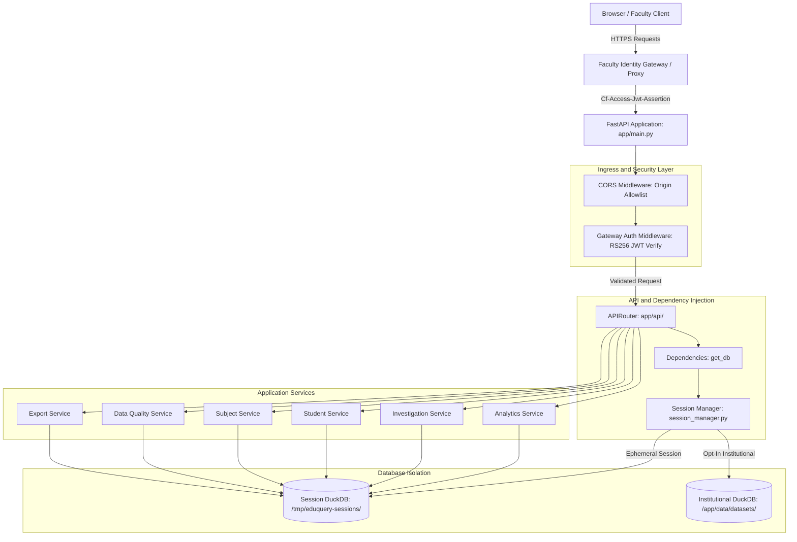

# EduQuery - System Architecture Specification

## 1. System Goals and Non-Goals

### Goals
- Deterministic Marksheet Analysis: Ingest wide, complex college marksheet workbooks (including multi-tier merged headers, disparate division layouts, and varying grading schemes) into an analytical relational schema.
- Traceable Academic Outcomes: Provide provable answers to primary faculty questions:
  1. Student-level breakdown: Exactly which subjects a student passed, failed, or has unresolved, reconciled with printed marksheet totals.
  2. Subject-level failure listings: Comprehensive roster of students failing any given course, with component-level scores and division filtering.
  3. Data quality assurance: Immediate identification of anomalies (duplicate student IDs, sum mismatches, out-of-range marks).
- High-Performance Vectorized Querying: Leverage DuckDB for in-process SQL execution, achieving low-latency response times without external database services.
- Privacy-First Analysis: Provide ephemeral in-memory analysis sessions by default with zero permanent persistence, alongside opt-in institutional dataset storage.
- Strict Separation of Concerns: Isolate HTTP parsing, application workflows, academic domain invariants, and data access.

### Explicit Non-Goals
- No Large Language Models (LLMs): Zero chatbot functionality, neural query planners, LoRA fine-tuning, or generative text. Faculty require deterministic, auditable numbers, not probabilistic approximations.
- No Universal Passing Threshold: Academic passing policies vary across universities, courses, and component types (e.g., separate passing on theory ESE vs combined total). The system never enforces an arbitrary numeric threshold (e.g. `marks >= 40`).
- No Data Fabrication or Clamping: Blank, zero (`0.0`), absent (`AB`), and uncalculated values remain distinctly represented. Out-of-range marks are surfaced as warnings without silent clamping or truncation.
- No Direct Academic Logic in HTTP Controllers: Route handlers never evaluate pass/fail criteria or query DuckDB directly.

---

## 2. Preserved System Core

The core domain logic is implemented across the following packages:

```text
app/
├── core/
│   ├── catalog.py       # Multi-sheet layout classification and fingerprinting
│   ├── ingest.py        # Multi-tier layout induction, cell normalization, DuckDB loading
│   ├── models.py        # Strongly typed domain dataclasses (Student, Course, Score, etc.)
│   ├── database.py      # Relational DDL (8 tables), bulk populator, connection helper
│   ├── gateway_auth.py  # Faculty Identity Gateway (Cloudflare Access JWT, RS256, origin security)
│   └── data_quality.py  # Academic integrity validator (Checks 1-10)
├── reports/
│   ├── student_breakdown.py  # resolve_student (wildcard-hardened) and get_student_breakdown
│   └── subject_failures.py   # resolve_course, get_subject_failures, list_all_subjects_failure_summary
├── services/
│   ├── analytics_service.py     # Cohort overview analytics and metric aggregation
│   ├── anomaly_detection.py     # Tier A/B/C anomaly detector and review store
│   ├── data_quality_service.py  # Data quality audit service
│   ├── export_service.py        # Sanitized CSV roster and report exports
│   ├── investigation_service.py # Interactive multi-condition filter engine
│   ├── session_manager.py       # Ephemeral session lifecycle, download tickets, isolation
│   ├── student_service.py       # Student roster and breakdown orchestration
│   └── subject_service.py       # Course catalog and failure report orchestration
└── api/
    ├── dependencies.py          # Request-scoped database dependencies (get_db)
    ├── router.py                # Master API router (/api/v1)
    └── routes/                  # REST endpoint handlers
```

### Relational Schema (Core Tables)
1. `students`: Demographics, seat numbers, roll numbers, division, overall result, SGPI/CGPA, workbook provenance.
2. `courses`: Course code, full title, kind (`theory` vs `practical`), credits, component structure.
3. `scores`: Atomized component marks (e.g. `TH`, `IA`, `PR`, `OR`), flags, states (`marked`, `not_enrolled`, `uncalculated`, `flagged`, `unparsed`), raw text.
4. `grades`: Course-level letter grades (`O`, `A`, `F`, etc.).
5. `enrollment`: Explicit `(student_id, course_code)` pairs defining verified cohort membership.
6. `reconciliation`: Comparison of computed component sums against printed totals, recording discrepancies and flags.
7. `layout_profiles`: Structural fingerprints and layout specifications per sheet.
8. `quality_findings`: Audit findings categorized by severity (`error`, `warning`, `info`).

---

## 3. Layer Boundaries and Request Flow



### Layer Responsibility Matrix

| Layer | Module Path | Primary Responsibility | Forbidden Behaviors |
| :--- | :--- | :--- | :--- |
| API Layer | `app/api/` | HTTP routing, parameter parsing, status codes, Pydantic validation, error envelopes, exception handling. | No direct SQL execution; no pass/fail evaluation; no raw DuckDB row serialization. |
| Security Layer | `app/core/gateway_auth.py` | JWT signature verification, audience/issuer validation, fail-closed handling, origin bypass blocking. | No bypass without explicit configuration; no exposed internal errors. |
| Service Layer | `app/services/` | Use-case orchestration, pagination/sorting, filter building, export sanitization, session lifecycle. | No direct HTTP response handling; no unparameterized SQL queries. |
| Report Engines | `app/reports/` | Academic classification, candidate resolution, cohort reconciliation. | No HTTP awareness; no hardcoded pass thresholds. |
| Persistence / Dependency | `app/api/dependencies.py` | Request-scoped connection lifecycle (`get_db`) with automatic closing and 503 unavailability signaling. | No connection leakage across requests; no unhandled lock retention. |
| Ingestion Core | `app/core/` | Excel layout induction, sheet cataloging, cell token parsing, provenance tracking. | No silent data clamping or truncation without tracking. |

---

## 4. Concurrency Strategy and Session Isolation

### DuckDB Concurrency Invariants
- DuckDB natively supports multiple concurrent read connections against a database file in read-only mode.
- DuckDB supports exactly one write connection at any given time.
- In-memory databases (`:memory:`) are isolated to their specific connection handle.

### Dual-Topology Storage Strategy

1. **Mode A: Ephemeral Analysis Sessions (Default)**:
   - Path: Configured by `EDUQUERY_TEMPORARY_SESSIONS_DIR` (defaults to `/tmp/eduquery-sessions` on Linux/Docker, or `data/sessions` locally).
   - Identification: Cryptographically random 32-byte URL-safe base64 token.
   - Isolation: Each session has its own isolated `session.duckdb`, `meta.json`, and review state.
   - Erasure: Calling `DELETE /api/v1/session` erases all session files on disk and clears cookies.
   - Inactivity Cleanup: Automatic removal after `EDUQUERY_IMPORT_SESSION_TTL_SECONDS` (default: 3600s / 1 hour).
   - Zero Institutional Persistence: Does not touch `active_dataset.json` or write to `/app/data/datasets`.

2. **Mode B: Institutional Persistent Storage (Opt-In Only)**:
   - Path: `/app/data/datasets/` and `/app/data/reviews/`.
   - Activation: Authoritative pointer `/app/data/active_dataset.json` updated via atomic rename (`os.replace`) and filesystem synchronization (`os.fsync`).
   - Versioning: Datasets are stored with timestamped filenames, allowing active readers to complete queries against existing datasets during promotion.
   - Recovery: On restart, `create_app` inspects the pointer file, verifies table schemas, and falls back gracefully if missing or corrupt.

---

## 5. Security Architecture

1. **Zero Logging of Student PII**:
   - Application logs record event types, course codes, row counts, durations, and HTTP status codes.
   - Student names, roll numbers, email addresses, and raw marks are never logged.

2. **Faculty Identity Gateway**:
   - Validates Cloudflare Access RS256 JWT assertions (`Cf-Access-Jwt-Assertion` or `Bearer <jwt>`).
   - Enforces correct audience (`aud`), issuer (`iss`), expiration (`exp`), and key ID (`kid`).
   - Fails closed with HTTP 500 when authentication is required but unconfigured.
   - Blocks direct origin access via Render hostnames with HTTP 401.

3. **Strict CORS Allowlisting**:
   - Matches origins strictly against configured allowlists (`EDUQUERY_CORS_ORIGINS`).
   - Rejects lookalike domain attacks (`*.attacker.com`) and unlisted subdomains.
   - Never allows credentials (`Access-Control-Allow-Credentials`) on wildcard (`*`) origins.

4. **Export Protection**:
   - Single-use, 60-second atomic download tickets (`POST /api/v1/session/download-ticket`).
   - Removal of session tokens from GET query strings.
   - Formula injection neutralization on all CSV exports (command prefixes `=, +, -, @, \t, \r` are escaped).

5. **SQL Parameterization**:
   - All database queries use parameter substitution (`?`).
   - Wildcard characters in search queries are escaped (`escape_like_pattern`) using `ESCAPE '!'`.

---

## 6. Academic Classification and Invariant Verification

- Enrollment Denominators: Course catalogs and failure rates calculate against `enrolled_count`, never assuming the entire cohort took an elective course.
- Mutually Exclusive Electives: For 1-of-N elective groups, each student is enrolled in exactly one elective course.
- Absence vs. Zero Distinction: Absence markers (`AB`, `ABS`) are preserved distinctly from numeric zeros (`0.0`).
- Disambiguation: Ambiguous search queries return HTTP 409 Conflict with all matching candidates instead of guessing.
