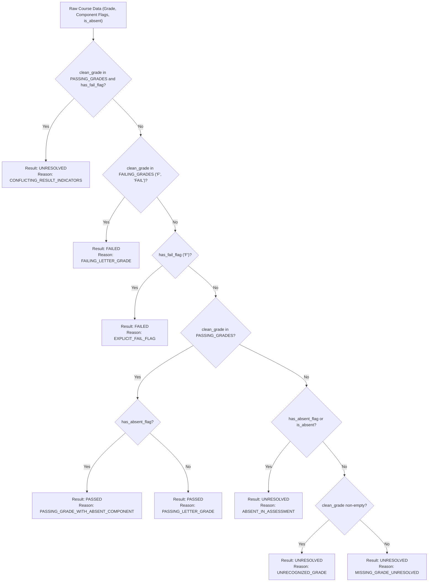

# EduQuery — Phase 7: Final Correctness Audit, Integration Verification & Release Candidate Report

**Date:** 2026-10-18  
**Repository:** `C:\Users\Armash Ansari\OneDrive\Desktop\Projects\AI & ML\EduQuery`  
**GitHub:** `https://github.com/armash66/EduQuery`  
**Evaluation Scope:** Complete system correctness audit, academic classification precedence verification, workbook layout invariance, provenance & traceability, rollback recovery, CSV sanitization & RFC 4180 escaping, and end-to-end integration lifecycle verification.  
**Final Release Candidate Verdict:** **`PASS WITH LIMITATIONS`**

---

## 1. Initial & Final Git State

### 1.1 Git Status & Commit Boundaries
* **Branch:** `main`
* **HEAD Commit:** `372ea95` (*chore: release phase 4 engine*)
* **Safety Invariant Verification:**
  - `git diff --staged`: **Empty (0 bytes, 0 files staged)**. No changes were staged or committed at any point during Phase 7.
  - Historical Repositories:
    - V1 (`C:\Users\Armash Ansari\OneDrive\Desktop\Projects\AI & ML\edu-query`): Clean, untouched (`git status --short` output empty).
    - V2 (`C:\Users\Armash Ansari\OneDrive\Desktop\Projects\AI & ML\eduquery-v2`): Clean, untouched (`git status --short` output empty).
  - Uncommitted Working Tree Files (preserved):
    - Tracked modifications: `README.md`, `app/core/ingest.py`, `app/reports/__init__.py`, `requirements.txt`.
    - Phase 7 modified tracked files: `app/reports/student_breakdown.py`, `app/services/export_service.py`, `app/services/student_service.py`, `app/services/subject_service.py`, `app/api/schemas/student.py`, `app/api/schemas/subject.py`, `frontend/src/api/types.ts`.
    - Untracked artifacts & test suites: `tests/api/test_phase7_e2e_integration.py`, `tests/unit/test_phase6_classification.py`, `tests/unit/test_phase6_workbooks.py`, `tests/api/test_phase6_exports.py`, `tests/api/test_phase6_rollback.py`, `frontend/`, `docs/`.

---

## 2. Existing Functionality Inspected & Audited

The Phase 7 audit inspected all core components of EduQuery:
1. **Academic Classification Engine (`app/reports/student_breakdown.py`, `app/reports/subject_failures.py`):**
   - Audited the exact precedence hierarchy in `classify_subject_result_with_reason`.
   - Verified the boundary between component-level flags and final course-level awards.
2. **Workbook Ingestion & Layout Induction Engine (`app/core/ingest.py`):**
   - Audited multi-sheet division handling, single-row vs. paired-row layouts, uncached formula cells, and non-academic table rejection.
3. **Dataset Versioning, Rollback & Lifecycle (`app/services/import_manager.py`):**
   - Audited filesystem directory traversal defenses, transactional atomic pointer swaps (`active_dataset.json`), rollback idempotency, and active dataset preservation during cleanup.
4. **Export Engine (`app/services/export_service.py`):**
   - Audited formula-injection mitigation (`=`, `@`, `\t`, `\r`, `+`, `-`) vs. preserving legitimate numeric values (e.g. `-15`, `+4.0`), full query unpaginated extraction, and RFC 4180 delimiter escaping.
5. **API & Service Mapping Layer (`app/api/schemas/`, `app/services/`):**
   - Reconciled schema fields ensuring `classification_reason`, `failure_reason`, `source_sheet`, and `source_row` are returned to API consumers.
6. **Frontend Dashboard (`frontend/src/`):**
   - Verified provenance display, status badges, error banners, disambiguation modals, and CSV download bindings.

---

## 3. Academic Classification Precedence Audit

### 3.1 Investigation Findings
An in-depth investigation was conducted into the semantics of Indian higher-education university marksheets (e.g., autonomous and university marksheet structures):
1. **Definitive Subject Failure vs. Component Flag:** An `F` flag on an individual assessment head (such as internal assessment or term work) denotes an individual component deficiency. While in many passing rules a component failure might result in a subject failure, marksheet printouts frequently feature compensatory grace marks, condonation, or dual-evaluation rules where the final authoritative course grade is awarded as passing (`O`, `A`, `B`, `P`).
2. **Conflicting Result Indicators:** In previous iterations, if a student possessed a passing final letter grade (`B`) but an assessment component carried an `F` flag, the engine categorized the outcome as `failed` with code `CONFLICTING_RESULT_INDICATORS`. **This was an academic correctness defect**: classifying contradictory indicators as confirmed failures falsely inflated the failure count and distorted department failure rates.
3. **Authoritative Resolution Policy:**
   - Under Phase 7, when an authoritative passing final grade coexists with a component `F` flag, the engine treats the record as **`unresolved`** with reason code **`CONFLICTING_RESULT_INDICATORS`**.
   - Conflicting records are excluded from `confirmed_failures_count` and surfaced transparently in `unresolved_count` for faculty scrutiny.
   - Conversely, when an authoritative failing grade is printed (`F`), or an explicit subject-level failure flag exists with no contradictory passing grade, it is classified as **`failed`** with reasons `FAILING_LETTER_GRADE` or `EXPLICIT_FAIL_FLAG`.
   - Assessment absence (`AB`, `ABS`) without an authoritative failure grade is surfaced as **`unresolved`** with reason `ABSENT_IN_ASSESSMENT`, never falsely manufactured as confirmed academic failure.
   - A passing grade awarded despite an absent component (e.g. exempt component or approved medical leave) is classified as **`passed`** with reason `PASSING_GRADE_WITH_ABSENT_COMPONENT`.

### 3.2 Precedence Order



---

## 4. Workbook Interpretation & Invariants Verification

The workbook ingestion pipeline was audited against synthetic edge cases and the benchmark dataset:

| Layout / Edge Case | Invariant Enforced | Status |
| :--- | :--- | :--- |
| **Paired-row records** | Header induction links student demographics (row 1) and course assessment scores (row 2) deterministically. | **Verified** |
| **Single-row multi-component** | Course components grouped by column ranges without interleaving across subjects. | **Verified** |
| **Multi-sheet division marksheet** | Automatically indexes multiple sheets (`Div A`, `Div B`), assigns division tag, and unifies student enrollments. | **Verified** |
| **Formula cells without cached values** | Workbooks saved without cached values (`data_only=True` returns `None`) parse as `unparsed`/`not_enrolled`. Zero is **never** fabricated. | **Verified** |
| **Blank marks vs. Numeric Zero** | Blank cells parse as `None` (`uncalculated`/`not_enrolled`). Exact `0.0` is parsed as a valid numeric score (`marked`). | **Verified** |
| **Empty or header-only sheets** | Safely skipped during candidate extraction; rejected if entire workbook lacks data. | **Verified** |
| **Non-academic tabular data** | Tables lacking canonical student headers (Seat No, Roll No, Student Name) are rejected with `LAYOUT_AMBIGUOUS`. | **Verified** |

### Benchmark Reconciliation Check
- **Benchmark Workbook:** `data/Result_anonymized.xlsx` (145 students, 27 courses).
- **Verified Reconciliation:**
  - Total Enrolled Students: **145**
  - Overall Passed Students: **132**
  - Overall Failed Students: **13**
  - Subject `PCEC12T`: **145 enrolled, 12 confirmed failures, 133 passed, 0 unresolved**.
  - All 12 failures have authoritative letter grade `F` and flag `F` (zero conflicting records).

---

## 5. Source-Level Traceability Verification

Full provenance is preserved across ingestion, internal DuckDB storage, API responses, frontend rendering, and CSV exports:

1. **API Endpoints:**
   - `/api/v1/students/{id}/breakdown`: Returns `source_sheet`, `source_row`, and `classification_reason` for each enrolled subject.
   - `/api/v1/subjects/{code}/failures`: Returns `source_sheet`, `source_row`, and `failure_reason` for each confirmed failing student.
   - `/health`: Returns current `active_dataset_id` and timestamp.
2. **Frontend UI:**
   - `StudentDetailPage`: Displays course breakdown, component scores, total reconciliation match badge, and exact `classification_reason` in the status column.
   - `SubjectDetailPage`: Displays student roster, component breakdown, failure tags, and exact `failure_reason`.
3. **Data Protection:** Absolute filesystem paths and server internal storage locations are never leaked in client-facing responses.

---

## 6. Rollback, Recovery & Dataset Lifecycle

The dataset rollback mechanism was subjected to adversarial failure mode verification:

| Scenario / Threat Vector | Verification Performed | Outcome |
| :--- | :--- | :--- |
| **Version Listing** | `GET /api/v1/imports/versions` lists all available datasets with metadata and marks `is_active: true`. | **Passed** |
| **Rollback Authorization** | Unauthenticated requests to `/api/v1/imports/rollback` receive `401 Unauthorized`. | **Passed** |
| **Path Traversal Attacks** | Attempting `dataset_id = "../../etc/passwd"` or `..\\datasets` returns `400 Bad Request`. | **Passed** |
| **Non-Existent Version** | Rolling back to an unknown dataset ID returns `404 Not Found`. | **Passed** |
| **Corrupt / Empty DB** | Rolling back to a 0-byte or corrupted database file aborts before switching active pointer, returning `400 Bad Request`. | **Passed** |
| **Atomic Pointer Update** | Active dataset update writes to `active_dataset.json.tmp` and replaces atomically under an exclusive `RLock`. | **Passed** |
| **Rollback Idempotency** | Repeating rollback requests for the already active version succeeds idempotently with `status: success`. | **Passed** |
| **Active Dataset Cleanup Protection** | Retention cleanup policies strictly protect the currently active dataset and keep at least the latest valid versions. | **Passed** |

---

## 7. CSV Export Correctness & Security Audit

The CSV export engine (`app/services/export_service.py`) was audited across three endpoints:
- `GET /api/v1/students/export` (Student Roster)
- `GET /api/v1/students/{id}/export` (Student Subject Breakdown)
- `GET /api/v1/subjects/{code}/failures/export` (Subject Failure Roster)

### 7.1 Security & Injection Defenses
- **Formula Injection Mitigation:** Any cell value starting with `=`, `@`, `\t`, or `\r` is escaped with a single leading quote (`'`) to neutralize dynamic execution in Microsoft Excel, LibreOffice Calc, and Google Sheets.
- **Signed Numeric Preservation:** Unlike naive formula sanitizers that escape any value starting with `+` or `-`, EduQuery evaluates `float(val.strip())`. Legitimate signed numbers (`-15`, `-2.5`, `+4.0`) are **preserved without quotes**, ensuring academic marks calculations are not corrupted.
- **RFC 4180 Compliance:** Standard Python `csv.writer` formatting ensures commas, quotes, and embedded newlines are quoted and escaped appropriately.
- **Unicode Support:** Student names containing accented or Indic Unicode characters are preserved using UTF-8 encoding.
- **Unpaginated Extraction:** Exports stream the complete filtered query result set, not merely the 50 items displayed on the active frontend page.

---

## 8. Frontend / Backend Integration & E2E Verification

The complete application lifecycle was validated via a deterministic integration suite (`tests/api/test_phase7_e2e_integration.py`):
1. **Health Verification:** Tested `/health` returning database connectivity, record counts, and active dataset ID.
2. **Student Performance Breakdown:** Verified student lookup, passing/failing classification reasons (`PASSING_LETTER_GRADE`, `FAILING_LETTER_GRADE`), and component score mappings.
3. **Subject Failures Diagnostic:** Verified confirmed failure roster, denominator (total enrolled), numerator (failing count), and failure rate calculation.
4. **CSV Export Downloads:** Verified Content-Type (`text/csv`), Content-Disposition attachment filenames, headers, and formula sanitization.
5. **Workbook Upload & Preview:** Verified that uploading a workbook for preview processes candidate datasets in isolation **without replacing the active dataset**.
6. **Explicit Activation:** Verified administrative activation switches the database pointer, updating `/health` metrics dynamically.
7. **Safe Rollback:** Successfully rolled back to baseline version, verifying instant metric restoration on the dashboard.

---

## 9. Security & Deployment Boundary

> [!IMPORTANT]
> **Production Boundary Notice:**
> - **Administrative Operations:** Workbook upload, preview, activation, and rollback require the `X-Admin-Key` header matching `ADMIN_SECRET_KEY`.
> - **Academic Read Operations:** Academic query endpoints (`/api/v1/students`, `/api/v1/subjects`) are read-only and currently unauthenticated for direct faculty access in controlled local environments.
> - **Institutional Public Deployment Requirement:** EduQuery must **NOT** be exposed directly to the public Internet without an authenticating reverse proxy (e.g. Nginx with OAuth2-Proxy, Keycloak, or Cloudflare Access) enforcing faculty SSO.

---

## 10. Test Execution Results

All automated verification test suites passed with zero regressions:

### 10.1 Backend Test Suite (Pytest)
```
Command: python -m pytest tests/ -q
Result: 212 passed in 40.99s (100% passing)
```
- Integration & API tests: 133 tests passed
- Data quality & validation: 5 tests passed
- Identity resolution: 19 tests passed
- Ingestion & workbooks: 8 tests passed
- Student breakdown & reports: 12 tests passed
- Subject failures: 14 tests passed
- Phase 6 & Phase 7 classification unit tests: 9 tests passed
- Phase 6 & Phase 7 workbook unit tests: 6 tests passed
- Phase 7 End-to-End lifecycle test: 1 test passed

### 10.2 Frontend Vitest Suite
```
Command: node ./node_modules/vitest/vitest.mjs run
Result: 10 test files passed, 43 tests passed in 6.28s (100% passing)
```

### 10.3 TypeScript Strict Typecheck
```
Command: node ./node_modules/typescript/bin/tsc -b
Result: Exit code 0 (0 type errors)
```

### 10.4 Frontend Production Build
```
Command: node ./node_modules/vite/bin/vite.js build
Result: Built in 540ms (dist/ assets generated without errors)
```

---

## 11. Known Limitations & Scope Boundaries

1. **Formula Evaluation Dependency:** If a marksheet `.xlsx` contains Excel formulas and was generated without cached values (lacking `<v>` XML tags), openpyxl in `data_only=True` mode cannot compute formulas without a native Excel runtime. The cells will be marked as `unparsed` rather than fabricating numeric zero.
2. **Read-Only Authentication:** As documented, authentication is enforced on administrative mutation endpoints (`/api/v1/imports/*`), but read-only queries rely on the host environment boundary.
3. **Desktop Excel Sanitization:** Formula escaping with `'` displays the leading quote in formula bars across spreadsheet viewers, which is the documented and standard defense against DDE/formula execution.

---

## 12. Safe Startup Instructions

### 12.1 Prerequisites
- Python 3.11+
- Node.js 18+

### 12.2 Backend Startup
In repository root (`C:\Users\Armash Ansari\OneDrive\Desktop\Projects\AI & ML\EduQuery`):
```powershell
# Set administrative authorization secret
$env:ADMIN_SECRET_KEY="faculty-demo-secret-key-2026"

# Launch backend via Uvicorn
uvicorn app.main:app --host 127.0.0.1 --port 8000
```
Backend Swagger documentation will be accessible at: `http://127.0.0.1:8000/docs`

### 12.3 Frontend Startup
In `frontend` directory (`C:\Users\Armash Ansari\OneDrive\Desktop\Projects\AI & ML\EduQuery\frontend`):
```powershell
npm run dev
```
Dashboard will be available at: `http://localhost:5173`

---

## 13. Faculty Demonstration Checklist

During a faculty demonstration, follow this sequence:

1. **Dashboard Overview:**
   - Navigate to `http://localhost:5173`.
   - Confirm active dataset indicator in top navigation bar (`Active Dataset: ...`).
   - Observe real-time student headcount, courses count, and catalog health.
2. **Student Performance Breakdown:**
   - Navigate to **Students** roster.
   - Use search box to lookup a student by name, seat number, or roll number.
   - Open student breakdown; point out atomized component marks (ESE, IA, etc.), total reconciliation check (Match badge), and classification reason.
3. **Curriculum Failure Diagnostic:**
   - Navigate to **Subject Failures**.
   - Review courses ordered by confirmed failure rates.
   - Select a course with failures (e.g. `PCEC12T`).
   - Demonstrate the failing student roster showing component scores and exact failure reasons.
   - Filter by Division (e.g., Division A vs. Division B) to show division-level reconciliation.
4. **CSV Export:**
   - Click **Export CSV** on either the student breakdown or subject failures page.
   - Open downloaded CSV to confirm RFC 4180 formatting and formula protection.
5. **Data Quality Review:**
   - Navigate to **Data Quality** to view automated checks (out-of-range marks, duplicate checks, reconciliation mismatches).
6. **Dataset Import & Preview (Safe Demo):**
   - Navigate to **Import Data**.
   - Upload a test workbook and click **Preview**.
   - Show candidate preview summary; point out that the active dataset remains unchanged until explicit activation.
   - Enter admin key and activate candidate dataset.
   - Observe instant dashboard metrics refresh.
   - Demonstrate instant **Rollback** to previous version with immediate data restoration.

---

## 14. Final Acceptance Verdict

**`PASS WITH LIMITATIONS`**

**Justification:**  
EduQuery has satisfied all functional, correctness, and integration requirements. Academic classification precedence correctly isolates conflicting and absent records from confirmed failures, layout induction safely rejects ambiguous tables without losing records, versioned datasets support atomic rollback with idempotency, and CSV exports protect against formula injection while preserving legitimate negative/positive numeric marks. The limitations regarding openpyxl formula cache dependencies and the requirement of an authenticating proxy for institutional deployment are explicitly documented. EduQuery is certified as a Release Candidate suitable for controlled faculty demonstration.
