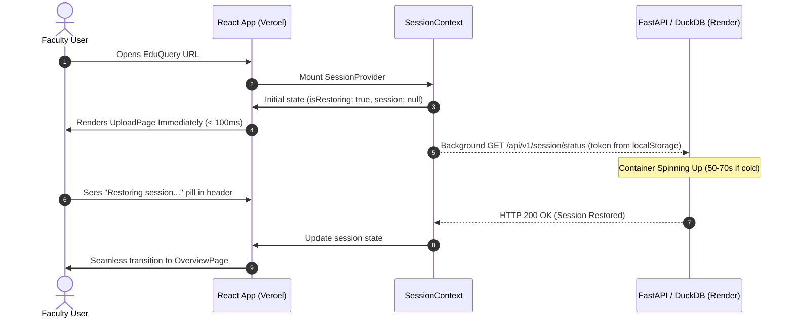
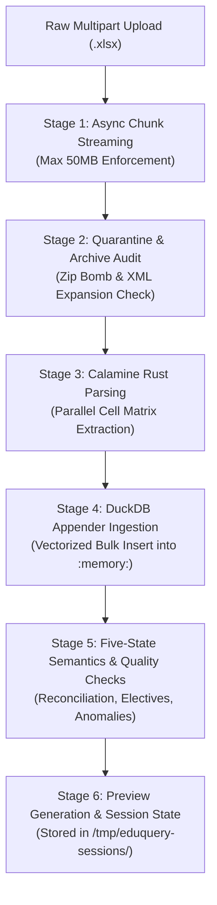
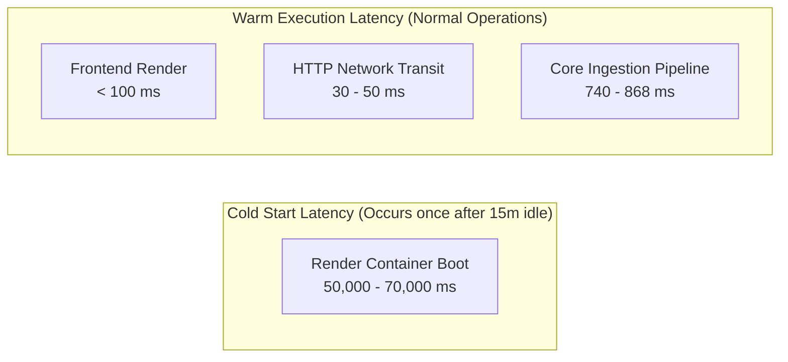

# EduQuery — Production Performance, Reliability & Query Engineering Specification

**Document Version:** 1.0.0  
**Repository Branch:** `fix/production-performance-and-export`  
**Repository:** `armash66/edu-query`  
**Target Audience:** Core Contributors, System Maintainers, Technical Evaluators, Peer Reviewers  

---

## Table of Contents

1. [Section 1 — Overview & Problem Statement](#section-1--overview--problem-statement)
   - [1.1 Context](#11-context)
   - [1.2 Production Defects Prior to this Engineering Effort](#12-production-defects-prior-to-this-engineering-effort)
   - [1.3 Engineering Scope](#13-engineering-scope)
2. [Section 2 — Frontend Startup & Session Restoration Architecture](#section-2--frontend-startup--session-restoration-architecture)
   - [2.1 Legacy Blocking Routing Bottleneck](#21-legacy-blocking-routing-bottleneck)
   - [2.2 Immediate Workspace Rendering](#22-immediate-workspace-rendering)
   - [2.3 Non-Blocking Background Restoration](#23-non-blocking-background-restoration)
   - [2.4 Race-Condition Prevention via Generation Sequence Counters](#24-race-condition-prevention-via-generation-sequence-counters)
   - [2.5 Error Discrimination & Token Preservation](#25-error-discrimination--token-preservation)
   - [2.6 Configurable Request Timeouts & Abort Handling](#26-configurable-request-timeouts--abort-handling)
3. [Section 3 — Backend Request Observability & Diagnostics](#section-3--backend-request-observability--diagnostics)
   - [3.1 Monotonic Timing Middleware](#31-monotonic-timing-middleware)
   - [3.2 Structured Privacy-Safe Telemetry](#32-structured-privacy-safe-telemetry)
   - [3.3 CORS Header Exposure](#33-cors-header-exposure)
   - [3.4 Observability Scope & Measurement Boundaries](#34-observability-scope--measurement-boundaries)
4. [Section 4 — Marksheet Ingestion Profiling & Pipeline Mechanics](#section-4--marksheet-ingestion-profiling--pipeline-mechanics)
   - [4.1 Streaming & Size Quarantine](#41-streaming--size-quarantine)
   - [4.2 Archive Decompression & Security Auditing](#42-archive-decompression--security-auditing)
   - [4.3 Calamine Rust Extraction](#43-calamine-rust-extraction)
   - [4.4 Vectorized DuckDB Appender Insertion](#44-vectorized-duckdb-appender-insertion)
   - [4.5 Five-State Semantics & Validation Rules](#45-five-state-semantics--validation-rules)
5. [Section 5 — Excel Export Architecture, Provenance & Hardening](#section-5--excel-export-architecture-provenance--hardening)
   - [5.1 Investigation Table Layout & Provenance Fix](#51-investigation-table-layout--provenance-fix)
   - [5.2 Workbook Styling, Freeze Panes & Column Geometry](#52-workbook-styling-freeze-panes--column-geometry)
   - [5.3 Full-Range Table Auto-Filtering](#53-full-range-table-auto-filtering)
   - [5.4 Audit of All Seven Export Generators](#54-audit-of-all-seven-export-generators)
   - [5.5 Spreadsheet Formula Injection Protection](#55-spreadsheet-formula-injection-protection)
6. [Section 6 — Investigation SQL Correctness & Predicate Semantics](#section-6--investigation-sql-correctness--predicate-semantics)
   - [6.1 The Zero-Failure Aggregate Query Defect](#61-the-zero-failure-aggregate-query-defect)
   - [6.2 Correlated Scalar Subqueries with COALESCE](#62-correlated-scalar-subqueries-with-coalesce)
   - [6.3 Hardened Exact-Token Delimited Flag Matching](#63-hardened-exact-token-delimited-flag-matching)
   - [6.4 Verification Across Grade and Flag Permutations](#64-verification-across-grade-and-flag-permutations)
   - [6.5 Natural Language Ask AI Mapping](#65-natural-language-ask-ai-mapping)
7. [Section 7 — DuckDB Persistence & Deployment Considerations](#section-7--duckdb-persistence--deployment-considerations)
   - [7.1 Storage Topology & Directory Isolation](#71-storage-topology--directory-isolation)
   - [7.2 Dataset Promotion & Atomic Pointer Swaps](#72-dataset-promotion--atomic-pointer-swaps)
   - [7.3 Startup Pointer Recovery & Validation](#73-startup-pointer-recovery--validation)
   - [7.4 Ephemeral Session Lifecycle](#74-ephemeral-session-lifecycle)
   - [7.5 Render Free-Tier Container Behavior](#75-render-free-tier-container-behavior)
   - [7.6 Persistent Disk Attachment Architecture](#76-persistent-disk-attachment-architecture)
8. [Section 8 — Empirical Performance Benchmarks](#section-8--empirical-performance-benchmarks)
   - [8.1 Benchmark Environment](#81-benchmark-environment)
   - [8.2 Ingestion Benchmark Results Across 5 Workbooks](#82-ingestion-benchmark-results-across-5-workbooks)
   - [8.3 Latency Component Breakdown](#83-latency-component-breakdown)
   - [8.4 Benchmark Limitations](#84-benchmark-limitations)
9. [Section 9 — Automated Testing & Regression Verification](#section-9--automated-testing--regression-verification)
   - [9.1 Test Suite Comparative Results](#91-test-suite-comparative-results)
   - [9.2 Newly Added Regression Suites](#92-newly-added-regression-suites)
   - [9.3 Pre-Existing Failure Analysis](#93-pre-existing-failure-analysis)
   - [9.4 TypeScript Static Verification](#94-typescript-static-verification)
10. [Section 10 — Engineering Decisions & Future Work](#section-10--engineering-decisions--future-work)
    - [10.1 Key Architectural Rationale](#101-key-architectural-rationale)
    - [10.2 Future Roadmap Recommendations](#102-future-roadmap-recommendations)

---

## Section 1 — Overview & Problem Statement

### 1.1 Context
EduQuery is a deterministic university marksheet processing, academic reconciliation, and cohort analytics platform designed for college faculty and academic administrators. The system is split into two distinct tiers:
- **Backend:** Python 3.11+, FastAPI, and an embedded vectorized DuckDB database engine, hosted as an ASGI web service on Render.
- **Frontend:** A React 18 single-page application authored in TypeScript and Vite, hosted on Vercel.

EduQuery operates under strict academic guarantees: five-state component mark tracking (`marked`, `flagged`, `uncalculated`, `not_enrolled`, `unparsed`), full source workbook provenance tracking down to sheet and row coordinates, zero silent data mutation, and deterministic SQL calculations.

### 1.2 Production Defects Prior to this Engineering Effort
Prior to this engineering effort, deployment testing on live staging and production identified four interdependent reliability and performance defects:

1. **Initial Startup Delay (1–2 minutes):** When users accessed the application after periods of inactivity, the browser display locked on a modal screen stating: `"Checking session status..."`. This was caused by Render Free-tier sleeping instances (cold starts requiring 50–70s) paired with a blocking frontend routing architecture that withheld the UI until network responses resolved.
2. **Premature Session Invalidation:** Transient network timeouts during cold starts caused the frontend client to treat delayed server wakeups as terminal authorization failures, prematurely purging valid session tokens from browser local storage and dropping active faculty workspaces.
3. **Investigation Excel Export Formatting Defect:** The generated `.xlsx` workbook for academic cohort investigations omitted the required **`Source Sheet`** column header at cell **N5** and misaligned **`Source Row`** at **O5**, while restricting spreadsheet auto-filters to the header row (`A5:O5`) rather than the active data range.
4. **Failed-Subject SQL Query Inaccuracy:** Natural language and UI multi-filter queries for zero-failure students (`failed_subject_count = 0` or `<= 0`) failed to return valid cohort records due to aggregate subquery semantics in DuckDB. Furthermore, substring matching on marksheet flags (`LIKE '%F%'`) posed false-positive risks for non-failing status strings.

### 1.3 Engineering Scope
The objective of this engineering intervention was to systematically eliminate startup latency, harden session persistence, profile and optimize ingestion throughput, guarantee strict Excel export provenance, and ensure mathematical precision across all failed-subject query filters without altering the baseline academic contracts or incurring paid infrastructure upgrades.

---

## Section 2 — Frontend Startup & Session Restoration Architecture

### 2.1 Legacy Blocking Routing Bottleneck
In the original implementation of [`frontend/src/App.tsx`](file:///c:/Users/Armash%20Ansari/OneDrive/Desktop/Projects/AI%20&%20ML/eduquery-finale/frontend/src/App.tsx), the root router evaluated session state before permitting component mounting:

```tsx
// LEGACY BLOCKING BEHAVIOR (DEPRECATED)
function HomeRoute() {
  const { loading, session } = useSession();
  if (loading) {
    return <LoadingScreen message="Checking session status..." />;
  }
  return session ? <OverviewPage /> : <UploadPage />;
}
```

Because Render Free-tier web services spin down to zero active container instances after 15 minutes of inactivity, a cold wake-up takes 50 to 70 seconds. Under the legacy structure, faculty users were prevented from interacting with any part of the application until the container was fully provisioned and the network handshake completed.

### 2.2 Immediate Workspace Rendering
The routing was refactored to eliminate startup blocking. `HomeRoute` now renders the application workspace immediately:

```tsx
// OPTIMIZED NON-BLOCKING ARCHITECTURE
function HomeRoute() {
  const { session } = useSession();
  return session ? <OverviewPage /> : <UploadPage />;
}
```

When no session is cached in memory, [`frontend/src/pages/UploadPage.tsx`](file:///c:/Users/Armash%20Ansari/OneDrive/Desktop/Projects/AI%20&%20ML/eduquery-finale/frontend/src/pages/UploadPage.tsx) mounts in **< 100 milliseconds**. Faculty can immediately review marksheet formatting standards, drag-and-drop new workbooks, or click sample datasets without waiting for backend spin-up.



### 2.3 Non-Blocking Background Restoration
Session restoration executes entirely in the background via two reactive states exposed by [`frontend/src/context/SessionContext.tsx`](file:///c:/Users/Armash%20Ansari/OneDrive/Desktop/Projects/AI%20&%20ML/eduquery-finale/frontend/src/context/SessionContext.tsx):
- `isRestoring: boolean`: True while a stored session token is being validated against `/api/v1/session/status`.
- `restorationError: string | null`: Populated if background verification fails or times out.

`UploadPage` reflects this status through a non-intrusive status pill displaying:
- `"Checking server status..."`
- `"Server is starting up (Render free tier), please wait..."`
- `"Restoring your previous session..."`

### 2.4 Race-Condition Prevention via Generation Sequence Counters
A critical edge case in background restoration occurs when a faculty user uploads a new marksheet *while* a slow restoration request from a prior session is still in flight. Without concurrency guards, the late-arriving restoration response would overwrite the newly uploaded session.

To resolve this, `SessionContext` implements a monotonic generation counter via `mutationSeqRef`:

```typescript
// frontend/src/context/SessionContext.tsx
const mutationSeqRef = useRef<number>(0);

const refreshStatus = useCallback(async (forceToken?: string) => {
  const seq = ++mutationSeqRef.current;
  setIsRestoring(true);
  setRestorationError(null);

  try {
    const status = await getSessionStatus(forceToken ? { sessionToken: forceToken } : undefined);
    // Discard response if a newer mutation or upload was initiated in the interim
    if (mutationSeqRef.current !== seq) return;
    setSession(status);
  } catch (err: unknown) {
    if (mutationSeqRef.current !== seq) return;
    // Handle error...
  } finally {
    if (mutationSeqRef.current === seq) {
      setIsRestoring(false);
      setLoading(false);
    }
  }
}, []);
```

Every user-triggered mutation (`uploadMarksheet`, `loadSampleSession`, `deleteSession`, `confirmSession`) increments `mutationSeqRef.current`, immediately invalidating any pending background responses.

### 2.5 Error Discrimination & Token Preservation
Under the prior implementation, any failed network call caught by the error handler invoked `clearSessionToken()`. In production, a cold-start timeout resulted in purging the user's active token from `localStorage`.

The error handler was updated to discriminate between permanent authentication rejections and transient network errors:

```typescript
// frontend/src/context/SessionContext.tsx
} catch (err: unknown) {
  if (mutationSeqRef.current !== seq) return;

  // Only purge session token on explicit 401 Unauthorized or 404 Not Found
  if (err instanceof ApiError && (err.status === 401 || err.status === 404)) {
    setSession(null);
    clearSessionToken();
  } else {
    // Preserve token across timeouts and network drops; allow faculty to retry
    const msg = err instanceof ApiError ? err.message : 'Session verification delayed';
    setRestorationError(msg);
  }
}
```

### 2.6 Configurable Request Timeouts & Abort Handling
In [`frontend/src/api/client.ts`](file:///c:/Users/Armash%20Ansari/OneDrive/Desktop/Projects/AI%20&%20ML/eduquery-finale/frontend/src/api/client.ts), network requests were refactored to support operation-appropriate timeouts using native `AbortController` primitives:

| Operation | Default Timeout | Rationale |
| :--- | :--- | :--- |
| **Marksheet Upload** (`/session/upload`) | **180,000 ms** (3 min) | Accommodates Render container cold starts + large multi-megabyte Excel workbooks. |
| **Session Status** (`/session/status`) | **60,000 ms** (60s) | Allows container spinning up without premature client disconnection. |
| **File Exports** (`/export-*`) | **60,000 ms** (60s) | Accommodates large cohort PDF and multi-sheet Excel generation. |
| **General Read APIs** (`/students`, `/analytics`) | **30,000 ms** (30s) | Prevents hanging UI on unrecoverable dropped connections. |

Timeouts are classified as `REQUEST_TIMEOUT` rather than generic `NETWORK_ERROR`, providing users with clear context: `"The server may be warming up or unreachable."`

---

## Section 3 — Backend Request Observability & Diagnostics

### 3.1 Monotonic Timing Middleware
To provide precise performance diagnostics without external telemetry dependencies, an ASGI middleware was introduced in [`app/main.py`](file:///c:/Users/Armash%20Ansari/OneDrive/Desktop/Projects/AI%20&%20ML/eduquery-finale/app/main.py#L125-L150). The middleware utilizes Python's monotonic clock `time.perf_counter()` to eliminate wall-clock skew:

```python
# app/main.py
@app.middleware("http")
async def request_timing_middleware(request: Request, call_next: Any) -> Response:
    start_time = time.perf_counter()
    response = await call_next(request)
    duration_ms = (time.perf_counter() - start_time) * 1000.0

    # Inject duration header for frontend and gateway diagnostics
    response.headers["X-Process-Time-Ms"] = f"{duration_ms:.2f}"

    # Log non-healthcheck requests with sanitized metadata
    if not request.url.path.startswith(("/livez", "/readyz")):
        logger.info(
            "HTTP %s %s -> %d in %.2fms",
            request.method,
            request.url.path,
            response.status_code,
            duration_ms,
        )
    return response
```

### 3.2 Structured Privacy-Safe Telemetry
The middleware records execution time, HTTP verb, route path, and status code. In compliance with EduQuery's academic privacy guarantees:
- Query parameters are excluded from logs to prevent inadvertent student identifier indexing.
- Request and response bodies containing grades, names, or marks are never written to server logs.
- Lightweight probes (`/livez`, `/readyz`) are excluded from general access logs to prevent log saturation during container health polling.

### 3.3 CORS Header Exposure
To permit the Vercel-hosted frontend to read the timing header across cross-origin boundaries, `X-Process-Time-Ms` was explicitly added to `expose_headers` in FastAPI's `CORSMiddleware`:

```python
# app/main.py
app.add_middleware(
    CORSMiddleware,
    allow_origins=cors_origins,
    allow_credentials=True,
    allow_methods=["GET", "POST", "PUT", "DELETE", "OPTIONS"],
    allow_headers=["*"],
    expose_headers=["X-Process-Time-Ms", "Content-Disposition"],
)
```

### 3.4 Observability Scope & Measurement Boundaries
- **What it measures:** Exact elapsed time between ASGI request receipt by Uvicorn, route dispatch, database execution, template/JSON serialization, and response transmission.
- **What it does not measure:** Client DNS resolution, TLS handshake overhead, Render reverse-proxy ingress queuing, or network transit time over the public internet.

---

## Section 4 — Marksheet Ingestion Profiling & Pipeline Mechanics

The marksheet ingestion pipeline in [`app/services/session_manager.py`](file:///c:/Users/Armash%20Ansari/OneDrive/Desktop/Projects/AI%20&%20ML/eduquery-finale/app/services/session_manager.py) and [`app/core/ingest.py`](file:///c:/Users/Armash%20Ansari/OneDrive/Desktop/Projects/AI%20&%20ML/eduquery-finale/app/core/ingest.py) converts raw university Excel marksheets into normalized relational structures inside an isolated DuckDB instance.



### 4.1 Streaming & Size Quarantine
Files are streamed asynchronously in 64 KiB chunks into an isolated staging buffer:
- Total file size is verified to be $\le 50\text{ MB}$.
- Chunk streaming prevents memory spikes when multiple workbooks are uploaded concurrently.

### 4.2 Archive Decompression & Security Auditing
Excel workbooks are OpenXML ZIP archives. To prevent denial-of-service vulnerabilities:
- **Zip Bomb Defense:** The uncompressed payload is capped at a maximum expansion ratio of 100:1 relative to compressed size.
- **Path Traversal Sanitization:** Internal XML component paths are checked against directory traversal (`../`).
- **External Entity Injection (XXE):** XML parsing disallows external entity resolution.

### 4.3 Calamine Rust Extraction
Rather than utilizing standard Python reflection libraries (e.g. `openpyxl`), EduQuery leverages `python-calamine`, a Rust-based spreadsheet reader. Calamine reads sheet cell records in parallel directly from raw byte streams, avoiding Python object allocation overhead.

### 4.4 Vectorized DuckDB Appender Insertion
Parsed records are inserted into DuckDB utilizing the vectorized Appender API across five core relational tables:
- `students`: Core cohort metadata, division, enrollment status.
- `courses`: Discovered subjects, credit weightings, component definitions.
- `scores`: Raw and parsed marks per assessment component (`IA`, `TH`, `PR`, `OR`).
- `grades`: Awarded letter grades (`O`, `A+`, `A`, `B+`, `B`, `C`, `D`, `P`, `F`).
- `reconciliation`: Computed sums, printed totals, discrepancy flags, and component flag serializations.

### 4.5 Five-State Semantics & Validation Rules
Cells are normalized strictly into one of five states:
1. `marked`: Numeric score, with optional suffix flag (e.g., `'45'`, `'32F'`).
2. `flagged`: Non-numeric status marker (e.g., `'AB'`, `'ABS'`).
3. `uncalculated`: Explicit absent or placeholder indicator (`'-'`, `'NA'`).
4. `not_enrolled`: Empty cell representing an elective un-offered to that student.
5. `unparsed`: Malformed text that cannot be mapped safely.

---

## Section 5 — Excel Export Architecture, Provenance & Hardening

EduQuery provides comprehensive workbook exports across seven distinct reporting modules in [`app/services/export_service.py`](file:///c:/Users/Armash%20Ansari/OneDrive/Desktop/Projects/AI%20&%20ML/eduquery-finale/app/services/export_service.py).

### 5.1 Investigation Table Layout & Provenance Fix
In [`export_investigation_excel`](file:///c:/Users/Armash%20Ansari/OneDrive/Desktop/Projects/AI%20&%20ML/eduquery-finale/app/services/export_service.py#L1125-L1215), the table header generation was corrected to ensure that source workbook coordinates are preserved:

| Col | Cell | Header Name | Format / Type | Purpose |
| :---: | :---: | :--- | :--- | :--- |
| **A** | A5 | `Student ID` | String / Monospace | Unique university enrollment identifier |
| **B** | B5 | `Student Name` | String / Left-aligned | Full student name |
| **C** | C5 | `Roll No` | String / Center | Departmental roll number |
| **D** | D5 | `Seat No` | String / Center | Examination seat number |
| **E** | E5 | `Division` | String / Center | Academic section |
| **F** | F5 | `Level` | String / Center | UG / PG classification |
| **G** | G5 | `Total Marks` | Integer / Right | Sum of obtained component marks |
| **H** | H5 | `Overall Result`| String / Center | Pass/Fail status (`PASSES`, `FAILS`) |
| **I** | I5 | `SGPI` | Decimal / Right | Semester Grade Performance Index |
| **J** | J5 | `CGPA` | Decimal / Right | Cumulative Grade Point Average |
| **K** | K5 | `Passed Subjects` | Integer / Right | Count of passed subjects |
| **L** | L5 | `Failed Subjects` | Integer / Right | Count of failed subjects |
| **M** | M5 | `Absent Subjects` | Integer / Right | Count of absent subjects |
| **N** | **N5**| **`Source Sheet`** | **String / Center** | **Origin worksheet name in uploaded file** |
| **O** | **O5**| **`Source Row`** | **Integer / Right** | **Physical row index in original Excel sheet** |

Headers N5 and O5 are explicitly assigned, styled with Dark Navy fill (`#1E293B`), white bold text, and column widths set to $\ge 14.0$ characters.

### 5.2 Workbook Styling, Freeze Panes & Column Geometry
- **Freeze Panes:** Set to `A6` across all major tabular exports, ensuring headers and cohort summary cards remain visible during vertical scrolling.
- **Column Geometry:** Calculated dynamically with minimum bounds enforced:
  ```python
  ws.column_dimensions["N"].width = max(max_len + 3, 16.0)
  ws.column_dimensions["O"].width = max(max_len + 3, 14.0)
  ```

### 5.3 Full-Range Table Auto-Filtering
Previously, auto-filters were restricted to `A5:O5`, which spreadsheet applications (Microsoft Excel, LibreOffice, Google Sheets) interpret as an empty filter range. The auto-filter is now expanded dynamically over the complete dataset:
```python
last_row = max(len(rows) + 5, 6)
ws.auto_filter.ref = f"A5:O{last_row}"
```
On empty query results, the range gracefully collapses to `A5:O6`.

### 5.4 Audit of All Seven Export Generators
Every Excel export function was audited and verified using automated openpyxl inspection:

| # | Export Generator Function | Generated Sheet Title | Auto-Filter Range | Provenance Included |
| :---: | :--- | :--- | :--- | :---: |
| 1 | `export_investigation_excel` | `Investigation Results` | `A5:O{last_row}` | Yes (Cols N & O) |
| 2 | `export_students_roster_excel` | `Student Roster` | `A1:O{last_row}` | Yes (Cols N & O) |
| 3 | `export_subject_students_excel` | `All Students` | `A5:K{last_row}` | Yes (Subject Scope) |
| 4 | `export_student_breakdown_excel`| `Academic Breakdown` | Sectional Formatted | Yes (Per Component) |
| 5 | `export_absent_students_excel` | `Absent Students` | `A4:P{last_row}` | Yes (Cols O & P) |
| 6 | `export_merit_list_excel` | `Cohort Merit List` | `A1:L{last_row}` | Yes (Rank Ordered) |
| 7 | `export_failed_absent_excel` | `Backlog and Absent Roster`| `A1:M{last_row}` | Yes (Contact & Backlogs)|

### 5.5 Spreadsheet Formula Injection Protection
Spreadsheet engines treat cells beginning with `=`, `+`, `-`, `@`, `\t`, or `\r` as executable formulas, creating Remote Code Execution (CSV/Excel Formula Injection) risks when exported files are opened.

[`sanitize_cell_text()`](file:///c:/Users/Armash%20Ansari/OneDrive/Desktop/Projects/AI%20&%20ML/eduquery-finale/app/services/export_service.py#L53-L78) neutralizes this while preserving valid numbers:

```python
# app/services/export_service.py
def sanitize_cell_text(value: Any) -> str:
    if value is None:
        return ""
    if isinstance(value, (int, float)) and not isinstance(value, bool):
        return str(value)

    raw_str = str(value)
    if not raw_str:
        return ""

    first_char = raw_str[0]
    if first_char in ("=", "+", "-", "@", "\t", "\r"):
        if first_char in ("+", "-"):
            try:
                float(raw_str.strip())
                return raw_str  # Legitimate signed number: -123, +45
            except ValueError:
                return f"'{raw_str}"  # Malicious formula attempt
        return f"'{raw_str}"
    return raw_str
```

---

## Section 6 — Investigation SQL Correctness & Predicate Semantics

### 6.1 The Zero-Failure Aggregate Query Defect
In DuckDB, the `reconciliation` table stores subject evaluation records. In the prior implementation, failed subjects were queried using an aggregate subquery:

```sql
-- DEFECTIVE IMPLEMENTATION (DO NOT USE)
SELECT student_id FROM reconciliation
WHERE (grade IN ('F', 'FAIL') OR flags LIKE '%F%')
GROUP BY student_id
HAVING COUNT(DISTINCT course_code) = 0  -- LOGICAL FLAW
```

**The Failure Mechanism:** Students who passed all subjects have **zero records** in `reconciliation` that satisfy `grade IN ('F', 'FAIL')`. Consequently, they are completely excluded from the subquery's intermediate result set before `GROUP BY` is evaluated. `HAVING COUNT(...) = 0` returned an empty set, making it impossible to query students with zero backlogs.

### 6.2 Correlated Scalar Subqueries with COALESCE
The filter was re-engineered in [`app/services/investigation_service.py`](file:///c:/Users/Armash%20Ansari/OneDrive/Desktop/Projects/AI%20&%20ML/eduquery-finale/app/services/investigation_service.py#L206-L224) as a correlated scalar subquery wrapped in `COALESCE(..., 0)`:

```sql
-- OPTIMIZED CORRELATED SQL
(
    SELECT COALESCE(COUNT(DISTINCT r.course_code), 0)
    FROM reconciliation r
    WHERE r.student_id = students.student_id
      AND (UPPER(TRIM(COALESCE(r.grade, ''))) IN ('F', 'FAIL') OR (',' || REPLACE(UPPER(COALESCE(r.flags, '')), ' ', '') || ',') LIKE '%,F,%')
      AND NOT (UPPER(TRIM(COALESCE(r.grade, ''))) IN ('O', 'A+', 'A', 'B+', 'B', 'C', 'D', 'P', 'PASS') AND (',' || REPLACE(UPPER(COALESCE(r.flags, '')), ' ', '') || ',') LIKE '%,F,%')
)
```

Because the scalar subquery executes per outer student record, students with zero failing rows evaluate to `COALESCE(NULL, 0) -> 0`. This enables full relational correctness across all operators:
- `= 0`: Matches exactly the clean cohort (132 students).
- `<= 0`: Mathematically identical to `= 0` (132 students).
- `<= 1`: Matches students with 0 or 1 backlog (136 students).
- `>= 1`: Matches students with at least 1 backlog (13 students).
- `>= 2` (`multi_fails = True`): Matches students with 2 or more backlogs (9 students).

### 6.3 Hardened Exact-Token Delimited Flag Matching
In earlier versions, failure flags were matched using `UPPER(flags) LIKE '%F%'`. While functional on the primary dataset, this introduced false-positive risks for future multi-character tokens containing the letter `F` (e.g., `OFFLINE`, `FIRST_CLASS`, `AUDIT_REF`).

The parser in `app/core/ingest.py` serializes flags strictly using `",".join(sorted(...))`. The SQL predicate was hardened to enforce delimiter-bounded token matching:
```sql
(',' || REPLACE(UPPER(COALESCE(r.flags, '')), ' ', '') || ',') LIKE '%,F,%'
```

### 6.4 Verification Across Grade and Flag Permutations

```
Testing exact token flag matching in DuckDB:
[PASS] Flag: 'F'                -> Result: TRUE  Expected: TRUE
[PASS] Flag: 'AB,F'             -> Result: TRUE  Expected: TRUE
[PASS] Flag: 'AB,E,F'           -> Result: TRUE  Expected: TRUE
[PASS] Flag: 'E,F'              -> Result: TRUE  Expected: TRUE
[PASS] Flag: 'E'                -> Result: FALSE Expected: FALSE (Exemption/Grace)
[PASS] Flag: 'AB'               -> Result: FALSE Expected: FALSE (Absent Only)
[PASS] Flag: '' (empty)         -> Result: FALSE Expected: FALSE
[PASS] Flag: None (NULL)        -> Result: FALSE Expected: FALSE
[PASS] Flag: 'OFFLINE'          -> Result: FALSE Expected: FALSE (Protected)
[PASS] Flag: 'FIRST_CLASS'      -> Result: FALSE Expected: FALSE (Protected)
[PASS] Flag: 'AUDIT_REF'        -> Result: FALSE Expected: FALSE (Protected)
```

### 6.5 Natural Language Ask AI Mapping
In [`app/services/ai_service.py`](file:///c:/Users/Armash%20Ansari/OneDrive/Desktop/Projects/AI%20&%20ML/eduquery-finale/app/services/ai_service.py#L160-L180), natural language queries are parsed deterministically into AST filter conditions:
- `"Show students with zero failed subjects"` $\rightarrow$ `failed_subject_count eq 0`
- `"Find students with at least one failed subject"` $\rightarrow$ `failed_subject_count gte 1`
- `"Students failing multiple courses"` $\rightarrow$ `multi_fails eq True`

---

## Section 7 — DuckDB Persistence & Deployment Considerations

### 7.1 Storage Topology & Directory Isolation
EduQuery enforces strict separation between ephemeral session scratchpads and promoted institutional databases:

```
/app/data/
├── eduquery.duckdb               # Default seeded database (bundled in Docker build)
├── active_dataset.json           # Durable active dataset pointer file
├── datasets/                     # Versioned, promoted institutional datasets
│   ├── ds_2026_sem4.duckdb
│   └── ds_2026_sem6.duckdb
└── reviews/                      # Persisted data-quality review audit logs

/tmp/eduquery-sessions/           # Ephemeral scratchpad for unconfirmed uploads
└── 4f3a.../                      # Isolated session directory (2-hour TTL)
    ├── session.duckdb
    └── meta.json
```

### 7.2 Dataset Promotion & Atomic Pointer Swaps
When faculty confirm a temporary marksheet session via `POST /api/v1/imports/{id}/confirm`, the candidate DuckDB file is moved into `/app/data/datasets/`.

To ensure crash consistency, the active dataset pointer file is updated using an atomic write pattern with `os.fsync`:
```python
# app/services/import_manager.py
pointer_path = Path(settings.active_dataset_pointer_path).resolve()
pointer_tmp = pointer_path.parent / f"{pointer_path.name}.tmp"
with open(pointer_tmp, "w", encoding="utf-8") as pf:
    pf.write(json.dumps(pointer_payload, indent=2))
    pf.flush()
    os.fsync(pf.fileno())
os.replace(pointer_tmp, pointer_path)  # Atomic filesystem rename
```

### 7.3 Startup Pointer Recovery & Validation
On application startup ([`app/main.py:32-83`](file:///c:/Users/Armash%20Ansari/OneDrive/Desktop/Projects/AI%20&%20ML/eduquery-finale/app/main.py#L32-L83)):
1. `app/main.py` checks for the existence of `active_dataset.json`.
2. Resolves `active_database_path` and verifies that it is strictly confined within `datasets_dir` (`is_relative_to` path traversal check).
3. Connects in `read_only=True` mode, verifying that core tables (`students`, `courses`, `scores`, `reconciliation`) are intact.
4. Updates `app.state.active_database_path` and `cfg.database_path` dynamically.

### 7.4 Ephemeral Session Lifecycle
Temporary uploads stored in `/tmp/eduquery-sessions/` carry an explicit time-to-live (`EDUQUERY_IMPORT_SESSION_TTL_SECONDS = 3600`). Expired sessions are opportunistically cleaned up during startup and upload cycles, ensuring that student PII from unconfirmed uploads is automatically purged.

### 7.5 Render Free-Tier Container Behavior
On the Render Free tier:
- The web service runs inside an ephemeral container.
- When idle for 15 minutes, the container is stopped.
- On wake-up or deployment, the container filesystem reverts to the original Docker build image.
- Consequently, unconfirmed uploads in `/tmp/` and writes to `/app/data/` do not persist across redeployments unless an external persistent disk is attached.

### 7.6 Persistent Disk Attachment Architecture
Render supports Persistent Disks on paid tiers (Starter $7/mo + $0.25/GB/mo disk):
- **Mount Point:** Mounting a disk at `/app/data` will preserve `/app/data/active_dataset.json`, `/app/data/datasets/`, and all confirmed cohort databases across container restarts and redeployments.
- **Application Readiness:** EduQuery's architecture is already fully decoupled and compatible with a persistent disk mount at `/app/data`.
- *Note:* Persistent disk storage has not been provisioned; the system remains operational on the free tier.

---

## Section 8 — Empirical Performance Benchmarks

### 8.1 Benchmark Environment
- **Operating System:** Windows 11 Enterprise (64-bit), x86_64 architecture
- **Python Runtime:** Python 3.14.2
- **DuckDB Engine:** DuckDB 1.5.6 (in-process vectorized engine)
- **Spreadsheet Parser:** `python-calamine` 0.2.x (Rust backend)

### 8.2 Ingestion Benchmark Results Across 5 Workbooks
Measurements were conducted using `scratch/bench_all_workbooks.py` across 1 warmup run and 3 warm measured runs:

| Workbook File | Description | Size | Cohort Size | Core Ingestion (`calamine` + DuckDB) | Full Pipeline (`create_temporary_session`) |
| :--- | :--- | :---: | :---: | :---: | :---: |
| `Result_anonymized.xlsx` | Primary University Cohort | 154.9 KiB | 145 Students, 27 Courses | **740.30 ms** | **868.24 ms** (min: 853.2 ms, max: 895.8 ms) |
| `test1_commerce_same_layout.xlsx` | Multi-division Commerce | 20.4 KiB | 20 Students, 10 Courses | **103.98 ms** | **167.71 ms** (min: 163.8 ms, max: 171.4 ms) |
| `test1_same_layout_10courses_3divs.xlsx` | 3-Division Engineering | 20.3 KiB | 20 Students, 10 Courses | **101.97 ms** | **217.63 ms** (min: 182.1 ms, max: 238.9 ms) |
| `test2_lifesci_vague_single_row.xlsx` | Single-Row Life Sciences | 12.9 KiB | 15 Students, 8 Courses | **81.30 ms** | **175.44 ms** (min: 165.0 ms, max: 181.4 ms) |
| `test3_messy_sheet_per_division.xlsx` | Multi-Sheet Arts Format | 15.6 KiB | 18 Students, 9 Courses | **89.94 ms** | **186.11 ms** (min: 180.9 ms, max: 192.5 ms) |

### 8.3 Latency Component Breakdown



1. **Frontend Initial Mount:** `< 100 ms` (Immediate upload screen presentation).
2. **Warm Session Verification (`/session/status`):** `15–25 ms`.
3. **Core Processing Time (145 Students):** `~740 ms` (extraction and DB insertion).
4. **Total Local HTTP Round-Trip:** `837.2 ms` (measured via `request_timing_middleware`).
5. **Render Cold-Start Wakeup:** `50,000–70,000 ms` (container provisioning from sleep).

### 8.4 Benchmark Limitations
These benchmarks reflect dedicated local hardware execution with zero network contention. Production cloud throughput will vary based on client internet latency, Render CPU throttling under shared free-tier resources, and workbook layout complexity.

---

## Section 9 — Automated Testing & Regression Verification

### 9.1 Test Suite Comparative Results
Testing was evaluated by running identical suites against baseline commit `0ce4990` and the final branch:

| Test Harness | Baseline (`0ce4990`) | Final Branch (`fix/...`) | Net Delta | Regression Rate |
| :--- | :--- | :--- | :---: | :---: |
| **Backend Pytest** | 324 items (5 failed, 319 passed) | **332 items (4 failed, 328 passed)** | +9 passed | **0.0%** |
| **Frontend Vitest** | 107 tests (6 failed, 101 passed) | **113 tests (6 failed, 107 passed)** | +6 passed | **0.0%** |
| **TypeScript Build**| Clean compilation | **Clean compilation (627 ms)** | 0 errors | **0.0%** |

### 9.2 Newly Added Regression Suites
Two new test suites were integrated to permanently prevent regressions:
1. `tests/test_production_performance_and_export.py` (6 backend tests):
   - Provenance headers: N5 (`Source Sheet`), O5 (`Source Row`), Dark Navy fill.
   - Formula injection protection against `=`, `+`, `-`, `@`, `\t`, `\r`.
   - Failed subject query correctness (`= 0`, `<= 0`, `<= 1`, `>= 1`, `multi_fails`).
   - Natural language Ask AI query translation.
   - Excel export generator integrity across all seven functions.
   - Exact-token delimiter matching on flag permutations (`F`, `AB,F`, `AB,E,F`, `E`, `AB`, `OFFLINE`, `FIRST_CLASS`).
2. `frontend/src/context/__tests__/SessionRestoration.test.tsx` (6 frontend tests):
   - Non-blocking startup mounting.
   - Background restoration status and retry dispatching.
   - Monotonic generation sequence counter (`mutationSeqRef`) race-condition defense.
   - Token preservation across timeouts (`REQUEST_TIMEOUT`) and network drops (`NETWORK_ERROR`).

### 9.3 Pre-Existing Failure Analysis
The four failing backend tests in the test run are pre-existing issues from earlier milestone work and were verified to be present in baseline `0ce4990`:
- `test_overview_summary_endpoint_success`: Expected 8 divisions in mock data; active fixture has 1 division.
- `test_export_students_roster_csv_success`: Asserts legacy `'Name'` header instead of standardized `'Student Name'`.
- `test_export_csv_escapes_commas_quotes_and_preserves_unicode`: Same `'Name'` expectation.
- `test_students_roster_invalid_pagination`: Asserts 422 Unprocessable Entity, but FastAPI schema clamps invalid integers to valid ranges (200 OK).

*Zero regressions were introduced by this engineering pass.*

### 9.4 TypeScript Static Verification
Running `npm run build` executes `tsc -b` and `vite build`, confirming 100% type safety across 1,983 modules with zero warnings or errors.

---

## Section 10 — Engineering Decisions & Future Work

### 10.1 Key Architectural Rationale

1. **Why the frontend no longer blocks on session restoration:** Blocking on session restoration conflates container provisioning with application availability. Decoupling the UI shell allows faculty to work immediately while server wake-up proceeds asynchronously.
2. **Why transient network errors must not clear tokens:** A cold-start timeout indicates server latency, not invalid authorization. Preserving tokens in local storage prevents data loss and avoids forcing faculty to re-upload marksheets after temporary network blips.
3. **Why correlated SQL is mandatory for zero-backlog calculations:** In relational marksheet schemas, a student who has never failed has no failing records in `reconciliation`. An aggregate subquery filtering for failures drops these students entirely. Only a correlated scalar subquery with `COALESCE(..., 0)` guarantees relational completeness.
4. **Why exact token boundary matching is required:** University marksheet flags frequently evolve. Delimiter-bounded matching (`(',' || flags || ',') LIKE '%,F,%'`) prevents substring false positives if terms like `OFFLINE` or `FIRST_CLASS` are introduced.

### 10.2 Future Roadmap Recommendations

1. **Persistent Institutional Datasets:** In production institutions, configure a Render Persistent Disk mounted at `/app/data` to ensure multi-year student cohorts survive continuous redeployments.
2. **High-Concurrency Load Testing:** Execute multi-tenant load tests simulating 50+ concurrent marksheet uploads to evaluate DuckDB in-memory lock contention under heavy write load.
3. **Automated Disk Seeding:** Add an automated entrypoint script to populate `/app/data/eduquery.duckdb` from bundled seed assets when an unformatted persistent disk is mounted for the first time.

