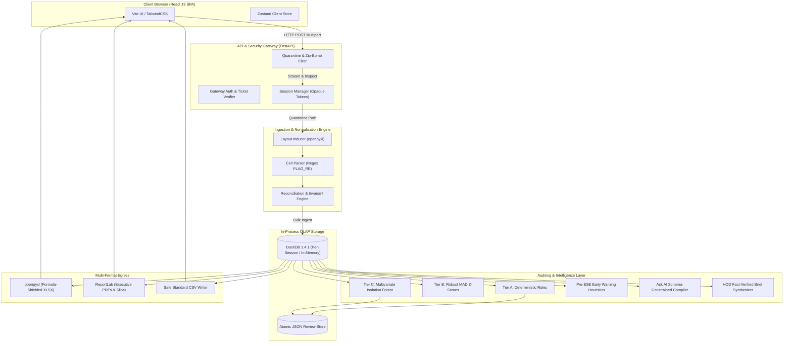
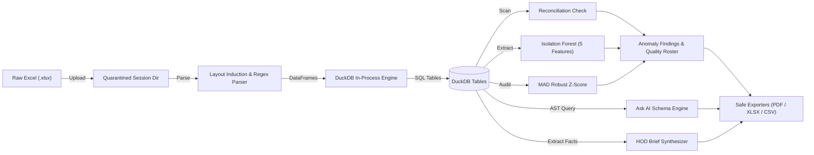
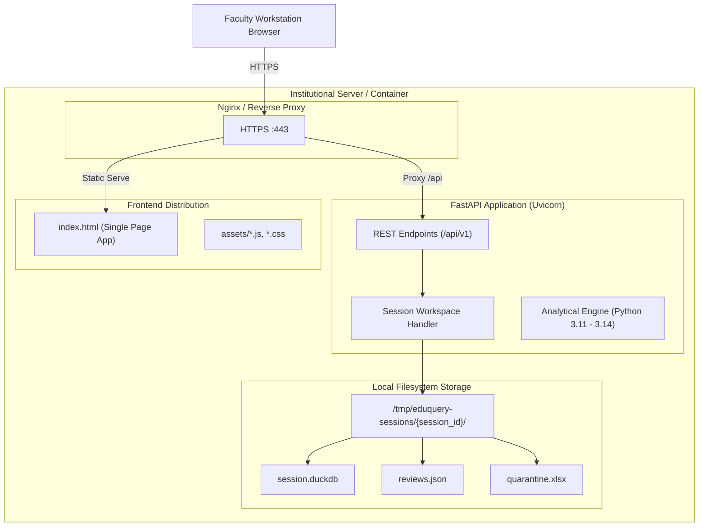
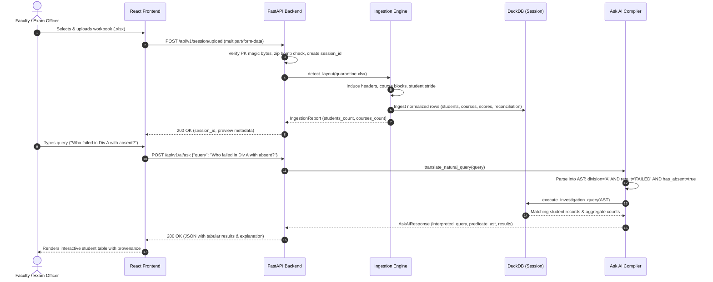

# Deliverable 02: System Architecture, Data Pipelines, DDL, and API Blueprint

## 1. End-to-End System Pipeline

The EduQuery V3 ingestion, analytical processing, and reporting architecture is structured into seven discrete, decoupled stages. Each stage is strictly isolated and fails safely with informative error messages.



### Detailed Stage Breakdown

#### Stage 1: Workbook Upload, Quarantine, and Security Verification
- **Primary Modules**: [`app/services/session_manager.py:create_temporary_session`](file:///c:/Users/Armash%20Ansari/OneDrive/Desktop/Projects/AI%20&%20ML/eduquery-v3/app/services/session_manager.py#L123-L212), [`app/core/gateway_auth.py`](file:///c:/Users/Armash%20Ansari/OneDrive/Desktop/Projects/AI%20&%20ML/eduquery-v3/app/core/gateway_auth.py)
- **Functions**: Streams raw bytes up to `max_upload_size_bytes` (default 30 MB). Enforces `.xlsx` container validation, OpenXML ZIP magic bytes check (`PK\x03\x04`), scans for zip-bombs (entry count $\le 1000$, uncompressed size $\le 100\text{ MB}$, compression ratio $\le 100\times$), rejects password-protected files and path traversals (`..`), writes safely to `quarantine.xlsx` inside a unique session directory with restricted filesystem permissions (`0o700`).

#### Stage 2: Layout Induction & Coordinate Inference
- **Primary Modules**: [`app/core/ingest.py:detect_layout`](file:///c:/Users/Armash%20Ansari/OneDrive/Desktop/Projects/AI%20&%20ML/eduquery-v3/app/core/ingest.py#L154-L380), [`build_merged_cell_map`](file:///c:/Users/Armash%20Ansari/OneDrive/Desktop/Projects/AI%20&%20ML/eduquery-v3/app/core/ingest.py#L135-L144)
- **Functions**: Constructs an $O(1)$ coordinate lookup cache for all openpyxl merged cell ranges. Scans the first 15 rows using regex patterns (`IDENTITY_PATTERNS`, `SUMMARY_PATTERNS`) to discover student identity columns (`seat_no`, `roll_no`, `name`, `division`, `email`, `elective_choice`) and cohort summary columns (`total_marks`, `sgpi`, `cgpa`, `total_credits`, `result`). Discovers heterogeneous course blocks (theory vs lab) by scoring header rows for examination keywords (`ESE`, `ISA`, `MSE`, `IA`, `TOT1`, `GRADE`, `CREDITS`). Extracts embedded course codes e.g. `[CE304]` and credit weights e.g. `[3 cr]`.

#### Stage 3: Stride Discovery & Cell Parsing
- **Primary Modules**: [`app/core/ingest.py:parse_cell`](file:///c:/Users/Armash%20Ansari/OneDrive/Desktop/Projects/AI%20&%20ML/eduquery-v3/app/core/ingest.py#L97-L133), [`_read_sheet_rows`](file:///c:/Users/Armash%20Ansari/OneDrive/Desktop/Projects/AI%20&%20ML/eduquery-v3/app/core/ingest.py#L383-L500)
- **Functions**: Dynamically computes student stride: detects paired-row formats (where row 1 contains component numerical scores and row 2 contains grades/credits) vs flat single-row formats by inspecting primary identity presence in alternating rows. Executes cell parsing via compiled regex `FLAG_RE`, decoupling numerical values, letter suffixes (e.g. `32F`, `18E`), explicit absentee flags (`AB`, `ABS`), uncalculated markers (`-`, `NA`), and missing elective enrollments.

#### Stage 4: Relational Normalization & DuckDB Loading
- **Primary Modules**: [`app/core/database.py:populate_table`](file:///c:/Users/Armash%20Ansari/OneDrive/Desktop/Projects/AI%20&%20ML/eduquery-v3/app/core/database.py#L97-L106), [`app/core/ingest.py:ingest`](file:///c:/Users/Armash%20Ansari/OneDrive/Desktop/Projects/AI%20&%20ML/eduquery-v3/app/core/ingest.py#L650-L750)
- **Functions**: Transforms extracted rows into vectorized pandas DataFrames and bulk-inserts them into in-memory or session-isolated DuckDB tables (`students`, `courses`, `scores`, `grades`, `enrollment`, `reconciliation`). Enforces relational keys and populates full provenance metadata (`source_sheet`, `source_row`).

#### Stage 5: Arithmetic Reconciliation & Invariant Auditing
- **Primary Modules**: [`app/core/ingest.py:_read_sheet_rows`](file:///c:/Users/Armash%20Ansari/OneDrive/Desktop/Projects/AI%20&%20ML/eduquery-v3/app/core/ingest.py#L500-L585), [`app/core/data_quality.py:run_data_quality_audit`](file:///c:/Users/Armash%20Ansari/OneDrive/Desktop/Projects/AI%20&%20ML/eduquery-v3/app/core/data_quality.py)
- **Functions**: Recomputes course component sums from raw assessment marks (`ESE + MSE + ISA`) and compares them against printed totals (`reconciliation` table). Flags arithmetic discrepancies (`|printed_total - computed_total| > 0.05`), out-of-bounds component scores ($<0$ or $>100$/$>150$), and credit sum mismatches into the `quality_findings` table.

#### Stage 6: Multi-Tier Anomaly Detection & Faculty Review
- **Primary Modules**: [`app/services/anomaly_detection.py:detect_all_anomalies`](file:///c:/Users/Armash%20Ansari/OneDrive/Desktop/Projects/AI%20&%20ML/eduquery-v3/app/services/anomaly_detection.py#L199-L680)
- **Functions**: Executes Tier A (deterministic arithmetic and boundary rules) and Tier C (multivariate Isolation Forest over 5 normalized dimensions: `mean_norm_score`, `score_dispersion`, `max_mismatch`, `fail_ratio`, `total_marks_ratio` with `contamination=0.05`). Optionally executes Tier B (Robust Z-Score with MAD scaling) in research mode. Merges findings with faculty review state stored in persistent JSON files (`{dataset_id}_reviews.json`).

#### Stage 7: Query Compilation, Briefing, and Export Egress
- **Primary Modules**: [`app/services/ai_service.py`](file:///c:/Users/Armash%20Ansari/OneDrive/Desktop/Projects/AI%20&%20ML/eduquery-v3/app/services/ai_service.py), [`app/services/export_service.py`](file:///c:/Users/Armash%20Ansari/OneDrive/Desktop/Projects/AI%20&%20ML/eduquery-v3/app/services/export_service.py)
- **Functions**: Translates natural language queries into deterministic AST filter predicates against DuckDB. Synthesizes executive HOD briefs with automated numeric verification auditing. Emits formula-safe spreadsheets (`openpyxl`), structured CSVs, and vector PDF reports (`ReportLab`).

---

## 2. Mermaid Architecture and Flow Diagrams

### Data Flow Diagram (Ingestion to Analytical Egress)


### Deployment Diagram


### Sequence Diagram: Upload $\rightarrow$ Analysis $\rightarrow$ Question Answering


---

## 3. Database Schema Definitions (DuckDB DDL)

EduQuery V3 uses DuckDB as an in-process, zero-dependency, analytical relational database. The schema is defined in [`app/core/database.py`](file:///c:/Users/Armash%20Ansari/OneDrive/Desktop/Projects/AI%20&%20ML/eduquery-v3/app/core/database.py#L10-L82).

```sql
-- 1. Student Identity and Academic Totals
CREATE TABLE students (
    student_id VARCHAR PRIMARY KEY,
    seat_no VARCHAR,
    roll_no VARCHAR,
    name VARCHAR,
    email VARCHAR,
    division VARCHAR,
    level VARCHAR,
    total_marks DOUBLE,
    total_credits DOUBLE,
    result VARCHAR,
    sgpi DOUBLE,
    cgpa DOUBLE,
    elective_choice VARCHAR,
    source_sheet VARCHAR,
    source_row INTEGER
);

-- 2. Course Catalog and Assessment Structure
CREATE TABLE courses (
    code VARCHAR PRIMARY KEY,
    name VARCHAR,
    kind VARCHAR,            -- 'theory' or 'lab'
    paired_code VARCHAR,     -- Paired practical/theory code
    credits DOUBLE,          -- Numerical credit weight
    credits_raw VARCHAR,
    components VARCHAR       -- Comma-separated list e.g. 'ESE,ISA,MSE,TOT1'
);

-- 3. Granular Assessment Scores and Component Flags
CREATE TABLE scores (
    student_id VARCHAR,
    course_code VARCHAR,
    component VARCHAR,       -- 'ESE', 'ISA', 'MSE', 'PR', 'TW', 'TOT1'
    value DOUBLE,            -- Numeric score (NULL if absent or uncalculated)
    flag VARCHAR,             -- Marker suffix e.g. 'F', 'E', 'AB', 'ABS'
    state VARCHAR,            -- 'marked', 'flagged', 'uncalculated', 'not_enrolled', 'missing'
    raw_text VARCHAR,        -- Exact literal cell text from Excel
    grade VARCHAR,
    source_sheet VARCHAR,
    source_row INTEGER,
    FOREIGN KEY (student_id) REFERENCES students(student_id),
    FOREIGN KEY (course_code) REFERENCES courses(code)
);

-- 4. Letter Grades per Student-Course Pair
CREATE TABLE grades (
    student_id VARCHAR,
    course_code VARCHAR,
    letter VARCHAR           -- 'O', 'A+', 'A', 'B+', 'B', 'C', 'D', 'P', 'F', 'AB'
);

-- 5. Student Course Enrollment Graph
CREATE TABLE enrollment (
    student_id VARCHAR,
    course_code VARCHAR
);

-- 6. Mark Reconciliation and Integrity Status
CREATE TABLE reconciliation (
    student_id VARCHAR,
    course_code VARCHAR,
    printed_total DOUBLE,    -- Total printed in spreadsheet source row
    computed_total DOUBLE,   -- Recomputed sum of component scores
    total_match BOOLEAN,     -- True if abs(printed - computed) <= 0.05
    grade VARCHAR,           -- Recorded official course grade
    flags VARCHAR            -- Reconciliation discrepancy markers
);

-- 7. Workbook Structural Fingerprints
CREATE TABLE layout_profiles (
    fingerprint VARCHAR,
    layout_spec VARCHAR,
    created_at TIMESTAMP DEFAULT CURRENT_TIMESTAMP
);

-- 8. Data Quality and Academic Integrity Findings
CREATE TABLE quality_findings (
    check_id VARCHAR,
    severity VARCHAR,        -- 'critical', 'warning', 'info'
    title VARCHAR,
    count INTEGER,
    problem VARCHAR,
    impact VARCHAR,
    recommended_action VARCHAR,
    details_json VARCHAR
);
```

---

## 4. API Endpoint Inventory

The system exposes 72 OpenAPI endpoints across 11 functional modules. Every endpoint is authenticated where required, enforces strict input schema validation via Pydantic, and sanitizes output data.

| Method | Path | Summary / Description | Tags |
| :--- | :--- | :--- | :--- |
| `GET` | `/api/v1/absent-students` | Get Absent Students Route | absent-students |
| `GET` | `/api/v1/absent-students/export` | Export Absent Students Excel Route | absent-students |
| `GET` | `/api/v1/absent-students/export-excel` | Export Absent Students Excel Route | absent-students |
| `POST` | `/api/v1/ai/ask` | Translate natural query into schema predicate AST and execute deterministically | ai |
| `GET` | `/api/v1/ai/hod-brief` | Generate 1-page executive performance brief verified against ground-truth facts | ai |
| `POST` | `/api/v1/ai/notice-draft` | Generate institutional notice template with placeholders | ai |
| `GET` | `/api/v1/analytics/distributions` | Get Distributions Endpoint | analytics |
| `GET` | `/api/v1/analytics/division-comparison` | Get Division Comparison Endpoint | analytics |
| `GET` | `/api/v1/analytics/failure-patterns` | Get Failure Patterns Endpoint | analytics |
| `GET` | `/api/v1/analytics/overview` | Get Overview Endpoint | analytics |
| `GET` | `/api/v1/analytics/registry` | Get Registry Endpoint | analytics |
| `GET` | `/api/v1/anomalies/evaluation` | Get empirical research evaluation report comparing deterministic, statistical, and ML baselines | anomalies |
| `GET` | `/api/v1/anomalies/findings` | List paginated explainable academic anomaly findings with optional filters | anomalies |
| `POST` | `/api/v1/anomalies/findings/{finding_id}/review` | Update faculty review status and moderation notes for an anomaly finding | anomalies |
| `POST` | `/api/v1/anomalies/students/{student_id}/review` | Update faculty review status for all anomaly findings concerning a specific student | anomalies |
| `GET` | `/api/v1/anomalies/summary` | Get aggregated anomaly detection metrics across deterministic, statistical, and ML methods | anomalies |
| `GET` | `/api/v1/data-quality` | Get Data Quality Route | data-quality |
| `POST` | `/api/v1/data-quality/review` | Record Quality Review Route | data-quality |
| `POST` | `/api/v1/imports/confirm` | Confirm Workbook Import | imports |
| `POST` | `/api/v1/imports/preview` | Preview Workbook Upload | imports |
| `POST` | `/api/v1/imports/rollback` | Rollback Dataset | imports |
| `GET` | `/api/v1/imports/versions` | Get Dataset Versions List | imports |
| `GET` | `/api/v1/imports/{import_id}` | Get Import Status | imports |
| `GET` | `/api/v1/investigation/capabilities` | Get supported investigation fields, operators, and dataset options | investigation |
| `POST` | `/api/v1/investigation/export-csv` | Download unpaginated formula-safe CSV export of matching investigation records | investigation |
| `POST` | `/api/v1/investigation/export-excel` | Download unpaginated Excel .xlsx export of matching investigation records | investigation |
| `POST` | `/api/v1/investigation/export/xlsx` | Download unpaginated Excel .xlsx export of matching investigation records (alias) | investigation |
| `POST` | `/api/v1/investigation/query` | Execute multi-condition investigation query with live count and pagination | investigation |
| `GET` | `/api/v1/overview/summary` | Get Overview Summary Endpoint | overview |
| `GET` | `/api/v1/reports/analysis-dossier/export` | Export Analysis Report Route | reports |
| `GET` | `/api/v1/reports/analysis-report/export` | Export Analysis Report Route | reports |
| `GET` | `/api/v1/reports/backlogs/export` | Export Backlogs Route | reports |
| `GET` | `/api/v1/reports/hod-brief/export-pdf` | Export Hod Brief Pdf Route | reports |
| `GET` | `/api/v1/reports/mail-merge/export` | Export Mail Merge Route | reports |
| `GET` | `/api/v1/reports/merit-list/export` | Export Merit List Route | reports |
| `GET` | `/api/v1/reports/slips` | Get Student Slips Route | reports |
| `GET` | `/api/v1/reports/slips/export-pdf` | Export Student Slips Pdf Route | reports |
| `DELETE` | `/api/v1/session` | Permanently delete current temporary session and all server-side records | session |
| `POST` | `/api/v1/session/confirm` | Confirm preview and activate the temporary session for analysis | session |
| `POST` | `/api/v1/session/delete` | Permanently delete current temporary session (POST fallback) | session |
| `POST` | `/api/v1/session/download-ticket` | Generate a single-use short-lived ticket for direct file downloads | session |
| `POST` | `/api/v1/session/sample` | Load anonymized sample dataset for instant analysis exploration | session |
| `POST` | `/api/v1/session/save` | Explicit opt-in to save current temporary dataset to institutional storage | session |
| `GET` | `/api/v1/session/status` | Check current active session or permanent dataset status | session |
| `POST` | `/api/v1/session/upload` | Upload marksheet into an isolated temporary analysis session | session |
| `GET` | `/api/v1/students` | Get Students | students |
| `GET` | `/api/v1/students/absent` | Get Absent Students Route | students |
| `GET` | `/api/v1/students/absent/components` | Get Absent Components Route | students |
| `GET` | `/api/v1/students/absent/export` | Export Absent Students Excel Route | students |
| `GET` | `/api/v1/students/absent/export-excel` | Export Absent Students Excel Route | students |
| `GET` | `/api/v1/students/absent/export/xlsx` | Export Absent Students Excel Route | students |
| `GET` | `/api/v1/students/early-warning` | Get pre-ESE at-risk early warning roster | students |
| `GET` | `/api/v1/students/export` | Export Students Route | students |
| `GET` | `/api/v1/students/export-excel` | Export Students Excel Route | students |
| `GET` | `/api/v1/students/export/xlsx` | Export Students Excel Route | students |
| `GET` | `/api/v1/students/subject-toppers` | Get division-wise highest scorers for each subject | students |
| `GET` | `/api/v1/students/{identifier}/breakdown` | Get Student Breakdown Route | students |
| `GET` | `/api/v1/students/{identifier}/export` | Export Student Breakdown Route | students |
| `GET` | `/api/v1/students/{identifier}/export-excel` | Export Student Breakdown Excel Route | students |
| `GET` | `/api/v1/subjects` | Get Subjects | subjects |
| `GET` | `/api/v1/subjects/absent/export` | Export Absent Subjects Excel Route | subjects |
| `GET` | `/api/v1/subjects/absent/export/xlsx` | Export Absent Subjects Excel Route | subjects |
| `GET` | `/api/v1/subjects/failure-summary` | Get Failure Summary | subjects |
| `GET` | `/api/v1/subjects/{course_code}/export-csv` | Export Course Students Csv Route | subjects |
| `GET` | `/api/v1/subjects/{course_code}/export-excel` | Export Course Students Excel Route | subjects |
| `GET` | `/api/v1/subjects/{course_code}/export-pdf` | Export Course Students Pdf Route | subjects |
| `GET` | `/api/v1/subjects/{course_code}/failures` | Get Course Failures | subjects |
| `GET` | `/api/v1/subjects/{course_code}/failures/export` | Export Course Failures Route | subjects |
| `GET` | `/api/v1/subjects/{course_code}/students` | Get Course Students Route | subjects |
| `GET` | `/health` | Health Check | system |
| `GET` | `/livez` | Liveness probe for container orchestration | system |
| `GET` | `/readyz` | Readiness probe for container orchestration | system |

---

## 5. Session Lifecycle, Isolation, and Retention Architecture

EduQuery V3 implements strict privacy boundaries by maintaining a bifurcated session architecture: **Temporary Ephemeral Sessions** vs **Persistent Datasets**.

### Session Workspace Structure
When a workbook is uploaded, the session manager generates an opaque token:
$$\text{session\_id} = \text{secrets.token\_urlsafe}(24).\text{replace}("-", "\_")$$

The session workspace is created under the configured session directory:
```
data/sessions/{session_id}/
├── quarantine.xlsx      (original uploaded marksheet)
├── session.duckdb       (isolated DuckDB database file)
├── reviews.json         (faculty moderation flags & notes)
└── meta.json            (session metadata, creation timestamp, file hash)
```

### Security and Isolation Invariants
1. **Zero Path Traversal**: Session tokens are strictly validated against `^[a-zA-Z0-9_\-]{16,64}$`. Any token with non-matching characters or directory separators (`/`, `\`, `..`) is rejected immediately with HTTP 400 (`INVALID_SESSION_TOKEN`).
2. **Filesystem Isolation**: File permissions on `session_dir` are restricted to `0o700`.
3. **No Collision with Institutional Data**: Temporary sessions write only to their own directory and never modify `data/eduquery.duckdb` or `data/datasets/`.
4. **Single-Use Download Tickets**: Direct file downloads (PDF/Excel) do not expose permanent URLs or session tokens in query strings. Instead, the frontend requests a short-lived ticket (`POST /api/v1/session/download-ticket`, TTL = 60 seconds). When consumed, the ticket is atomically removed from memory.
5. **Idempotent Deletion (`DELETE /api/v1/session`)**: Calling delete performs a complete tree deletion (`shutil.rmtree(session_dir)`), evicts DuckDB connections, and clears in-memory caches. Subsequent requests return HTTP 404.
6. **Automatic Abandonment Cleanup**: An opportunistic cleaner (`cleanup_expired_sessions`) runs during new uploads, sweeping all session directories older than the configured TTL (default 24 hours).

