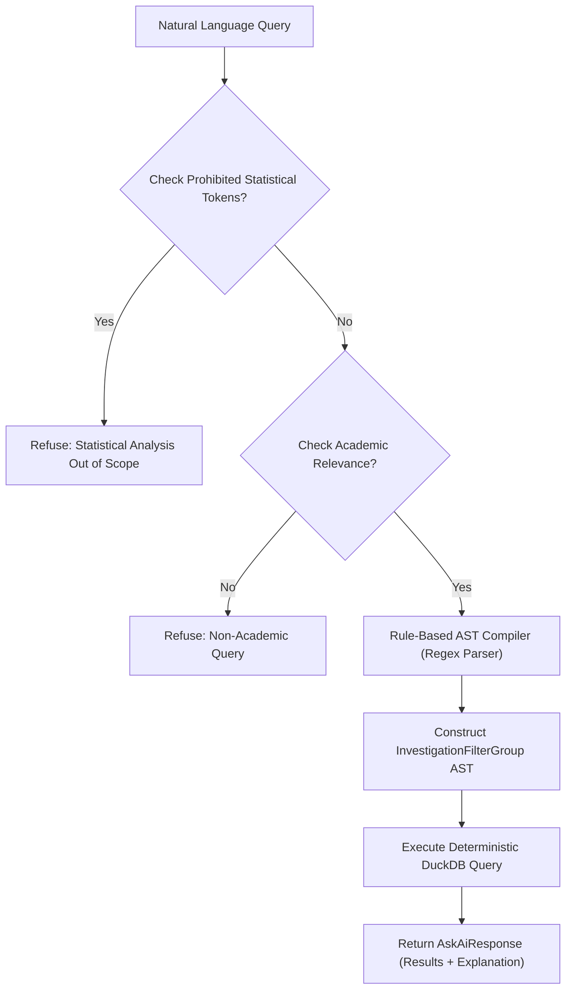

# Deliverable 03: Algorithmic Specifications, Formulations, and Complexity Analysis

## 1. Multi-Sheet Layout Induction & Coordinate Inference

### Description
The marksheet layout induction algorithm infers the two-dimensional coordinate structure of heterogeneous institutional marksheets without requiring prior layout registration or hardcoded column indexes. It handles multi-row merged headers, disparate column ordering across divisions, embedded course codes and credits, and varying student row strides.

### Inputs & Outputs
- **Inputs**: openpyxl `Worksheet` object $W$ of dimensions $R_{\max} \times C_{\max}$.
- **Outputs**: Layout dictionary containing:
  - Identity column map: $\text{identity} \subset \{\text{roll\_no}, \text{seat\_no}, \text{name}, \text{division}, \text{email}, \text{elective\_choice}\} \to \mathbb{N}$
  - Summary column map: $\text{summary} \subset \{\text{total\_marks}, \text{sgpi}, \text{cgpa}, \text{total\_credits}, \text{result}\} \to \mathbb{N}$
  - Course assessment blocks: List of `CourseBlock` tuples $(code, name, kind, start\_col, end\_col, components, total\_col, grade\_col, credits)$
  - Student data row indexes: $R_{data} \subset [1, R_{\max}]$
  - Stride factor: $stride \in \{1, 2\}$

### Mathematical Formulation & Heuristics
1. **Merged Cell Precomputation**: To prevent $O(R \cdot C)$ cell lookups during traversal, all merged ranges are pre-mapped into an $O(1)$ memory dictionary:
   $$\mathcal{M}(r, c) = W.\text{cell}(r_{top}, c_{left}).\text{value} \quad \forall (r, c) \in \text{range}(r_{min}\dots r_{max}, c_{min}\dots c_{max})$$

2. **Header Row Identification**: Rows $r \in [1, \min(R_{\max}, 15)]$ are scanned against regex dictionary $\mathcal{P}_{id}$ and $\mathcal{P}_{summary}$.
   - Trailing summary columns are assigned the rightmost column index:
     $$c_{sk} = \max \{c \mid \text{match}(W(r, c), \mathcal{P}_{sk}) \neq \emptyset\}$$

3. **Student Row Discovery**: With primary identity column $c_{id} = c_{roll} \lor c_{seat} \lor c_{name}$, data rows satisfy:
   $$R_{data} = \{r > \max(R_{header}) \mid W(r, c_{id}) \neq \emptyset \land \text{match}(W(r, c_{id}), \mathcal{P}_{id}) = \emptyset \land \exists c > c_{id}: W(r, c) \neq \emptyset\}$$

4. **Component Header Scoring**: The component header row $r_{comp}$ is inferred by maximizing an evaluation score over rows $1 \le r \le \min(R_{data}) - 1$:
   $$\text{Score}(r) = \sum_{c = c_{start}}^{C_{max}} \mathbb{I}(W(r, c) \in \mathcal{K}_{comp}) + 50 \cdot \mathbb{I}(\text{has\_total}(r)) + 50 \cdot \mathbb{I}(\text{has\_grades}(r))$$
   where $\mathcal{K}_{comp} = \{\text{ESE}, \text{ISA}, \text{MSE}, \text{IA}, \text{TOT1}, \text{TOTAL}, \text{CREDITS}, \text{GRADE}, \text{PR}, \text{TW}\}$.

5. **Stride Inference (Paired-Row Detection)**:
   $$stride = \begin{cases} 2, & \text{if } |R_{data}| \ge 2 \land \forall r \in R_{data}: W(r+1, c_{id}) = \emptyset \\ 1, & \text{otherwise} \end{cases}$$

### Pseudocode
```python
def detect_layout(ws):
    merged_map = build_merged_cell_map(ws)
    identity, summary = scan_identity_and_summary_headers(ws, scan_limit=15)
    if not ({"roll_no", "seat_no", "name"} & set(identity.keys())):
        raise AmbiguousLayoutError("No student identity column found")
    
    primary_id_col = identity.get("roll_no") or identity.get("seat_no") or identity.get("name")
    data_rows = find_valid_student_rows(ws, primary_id_col)
    best_comp_row = score_component_headers(ws, max_row=data_rows[0] - 1)
    course_row = find_course_title_row(ws, comp_row=best_comp_row)
    course_blocks = induce_course_blocks(ws, course_row, best_comp_row, merged_map)
    
    paired_rows = (len(data_rows) >= 2 and all(not ws.cell(r + 1, primary_id_col).value for r in data_rows))
    return {
        "identity_columns": identity,
        "summary_columns": summary,
        "course_blocks": course_blocks,
        "student_rows": data_rows,
        "rows_per_student": 2 if paired_rows else 1
    }
```

### Parameters & Defaults
- `scan_limit_row`: 15 (set in [`app/core/ingest.py:167`](file:///c:/Users/Armash%20Ansari/OneDrive/Desktop/Projects/AI%20&%20ML/eduquery-v3/app/core/ingest.py#L167))
- `comp_keywords`: 14 assessment tokens (set in [`app/core/ingest.py:213`](file:///c:/Users/Armash%20Ansari/OneDrive/Desktop/Projects/AI%20&%20ML/eduquery-v3/app/core/ingest.py#L213))
- Computational Complexity: Time $O(R_{\max} \cdot C_{\max})$, Space $O(R_{merge} \cdot C_{merge} + |R_{data}|)$.

---

## 2. Cell Parsing and Status Extraction

### Description
Parses heterogeneous spreadsheet cell strings containing composite numerical values, grading suffixes, absentee designations, and placeholder indicators into a strongly-typed 3-tuple.

### Mathematical Formulation
The parser applies the compiled regular expression:
$$\text{FLAG\_RE} = \verb|^\\s*(?P<number>[+-]?(?:\\d+(?:\\.\\d*)?|\\.\\d+))?\\s*(?P<flag>[A-Za-z]+)?\\s*$|$$

The semantic state function $S(v)$ is defined as:
$$S(v) = \begin{cases}
\text{'not\_enrolled'}, & \text{if } v \in \{\emptyset, \text{""}\} \\
\text{'uncalculated'}, & \text{if } v \in \{\text{'-'}, \text{'NA'}, \text{'N/A'}, \text{'--'}, \text{'null'}, \text{'None'}\} \\
\text{'unparsed'}, & \text{if } \text{FLAG\_RE.match}(v) = \emptyset \\
\text{'marked'}, & \text{if } \text{number} \neq \emptyset \\
\text{'flagged'}, & \text{if } \text{number} = \emptyset \land \text{flag} \in \{\text{'AB'}, \text{'ABS'}, \dots\}
\end{cases}$$

### Parameters & Code Location
- Implemented in [`app/core/ingest.py:97-133`](file:///c:/Users/Armash%20Ansari/OneDrive/Desktop/Projects/AI%20&%20ML/eduquery-v3/app/core/ingest.py#L97-L133).
- Complexity: $O(1)$ per cell.

---

## 3. Reconciliation & Arithmetic Invariant Auditing

### Description
Performs exact numerical verification across all student-course evaluations, comparing spreadsheet printed course totals against the sum of discrete component marks.

### Mathematical Formulation
Let $C_i$ be the set of enrolled courses for student $i$. For course $j \in C_i$, let $c_{ijk}$ be the score of component $k \in \{\text{ESE}, \text{ISA}, \text{MSE}, \text{PR}, \text{TW}\}$.
1. **Computed Total**:
   $$T_{computed, ij} = \sum_{k} c_{ijk}$$
2. **Reconciliation Gap**:
   $$\Delta_{ij} = |T_{printed, ij} - T_{computed, ij}|$$
3. **Integrity Invariant**:
   $$\text{reconciliation\_valid}(ij) \iff \Delta_{ij} \le 0.05$$
4. **Boundary Invariants**:
   $$c_{ijk} \in [0, 100] \quad \forall k \neq \text{TOT1}, \qquad T_{printed, ij} \in [0, 150]$$

- Parameter: Threshold $\epsilon = 0.05$ (floating-point tolerance, set in [`app/services/anomaly_detection.py:252`](file:///c:/Users/Armash%20Ansari/OneDrive/Desktop/Projects/AI%20&%20ML/eduquery-v3/app/services/anomaly_detection.py#L252)).
- Complexity: $O(N \cdot M)$ where $N$ is student count and $M$ is course count.

---

## 4. Multi-Tier Anomaly Detection Architecture

The system executes a 3-tier explainable anomaly detection framework designed to eliminate hallucination, guarantee explainability, and decouple mathematical errors from student performance variance.

```
+-----------------------------------------------------------------------+
| Tier A: Deterministic Integrity Rules                                  |
| |printed - computed| > 0.05  OR  score < 0 OR score > 100/150        |
+-----------------------------------------------------------------------+
                                   |
+-----------------------------------------------------------------------+
| Tier B: Robust Statistical Baseline (MAD / Robust Z)                 |
| Z_robust = (x - median) / max(1.4826 * MAD, 5.0) >= 3.0              |
+-----------------------------------------------------------------------+
                                   |
+-----------------------------------------------------------------------+
| Tier C: Multivariate Isolation Forest                                  |
| 5 normalized features, n_estimators=100, contamination=0.05, seed=42  |
+-----------------------------------------------------------------------+
```

### Tier A: Deterministic Verification Rules
- **Rule A1 (Mark Mismatch)**:
  $$\Delta_{ij} = |T_{printed, ij} - T_{computed, ij}| > 0.05$$
  - Severity: $\text{critical}$ if $\Delta_{ij} \ge 5.0$, else $\text{warning}$.
- **Rule A2 (Boundary Violation)**:
  $$c_{ijk} \notin [0, 100] \quad (k \neq \text{TOT1}) \quad \lor \quad T_{ij} \notin [0, 150]$$
  - Severity: $\text{critical}$.
- Code Location: [`app/services/anomaly_detection.py:246-372`](file:///c:/Users/Armash%20Ansari/OneDrive/Desktop/Projects/AI%20&%20ML/eduquery-v3/app/services/anomaly_detection.py#L246-L372).

### Tier B: Robust Statistical Baseline (Median Absolute Deviation)
- **Cohort Depth Requirement**: Course enrollment $N_j \ge 10$.
- **Formulation**:
  $$\text{median}_j = \text{median}_{i}(c_{ij})$$
  $$\text{MAD}_j = \text{median}_i (|c_{ij} - \text{median}_j|)$$
  $$\hat{\sigma}_j = \max(1.4826 \cdot \text{MAD}_j, 5.0)$$
  $$Z_{ij}^{\text{robust}} = \frac{c_{ij} - \text{median}_j}{\hat{\sigma}_j}$$
- **Threshold**: Flag if $|Z_{ij}^{\text{robust}}| \ge 3.0$ AND $|c_{ij} - \text{median}_j| \ge 15.0$ marks.
- Constants: Normal consistency scale factor $= 1.4826$, denominator floor $= 5.0$, $Z$-cutoff $= 3.0$, mark delta cutoff $= 15.0$.
- Code Location: [`app/services/anomaly_detection.py:378-468`](file:///c:/Users/Armash%20Ansari/OneDrive/Desktop/Projects/AI%20&%20ML/eduquery-v3/app/services/anomaly_detection.py#L378-L468).

### Tier C: Multivariate Numerical Isolation Forest
- **Cohort Depth Requirement**: Valid multi-course students $N \ge 15$.
- **Feature Vector $\mathbf{x}_i = (f_{i1}, f_{i2}, f_{i3}, f_{i4}, f_{i5}) \in \mathbb{R}^5$**:
  1. $f_{i1} = \frac{1}{100 |C_i|} \sum_{j \in C_i} T_{computed, ij}$ (Mean normalized score)
  2. $f_{i2} = \frac{1}{100} \sqrt{\frac{1}{|C_i|} \sum_{j \in C_i} (T_{computed, ij} - \overline{T}_i)^2}$ (Intra-student score dispersion)
  3. $f_{i3} = \max_{j \in C_i} |T_{printed, ij} - T_{computed, ij}|$ (Max arithmetic mismatch)
  4. $f_{i4} = \frac{|F_i|}{|C_i|}$ (Failed courses ratio, where score $< 40$)
  5. $f_{i5} = \frac{T_{marks, i}}{\max_{k} T_{marks, k}}$ (Total marks ratio)
- **Hyperparameters**:
  - `n_estimators`: 100
  - `contamination`: 0.05 (5%)
  - `random_state`: 42
  - `n_jobs`: 1
- **Inference & Scoring**:
  $$\text{Prediction: } \hat{y}_i = \text{predict}(\mathbf{x}_i) \in \{-1, +1\}$$
  $$\text{Anomaly Index: } \alpha_i = -\text{round}(\text{decision\_function}(\mathbf{x}_i), 3)$$
- Code Location: [`app/services/anomaly_detection.py:470-680`](file:///c:/Users/Armash%20Ansari/OneDrive/Desktop/Projects/AI%20&%20ML/eduquery-v3/app/services/anomaly_detection.py#L470-L680).

---

## 5. Merit List Generation & Competition Tie-Breaking

### Description
Computes the official departmental merit list over eligible passed candidates using a 6-tier lexicographic tie-breaking order and standard competition ranking ("1224").

### Exclusion Criteria
Students are excluded from the merit list if:
$$\text{result} \in \{\text{'FAILED'}, \text{'ATKT'}, \text{'FAIL'}\} \lor \text{result} \text{ contains 'ABS'} \lor \text{result} \text{ contains 'BACKLOG'}$$

### Lexicographic Sort Key
$$\mathbf{K}(s) = \left( \text{cgpa}_s \downarrow, \, \text{sgpi}_s \downarrow, \, \text{total\_marks}_s \downarrow, \, \text{seat\_no}_s \uparrow, \, \text{roll\_no}_s \uparrow, \, \text{name}_s \uparrow \right)$$

### Competition Ranking Algorithm ("1224")
Let $s_{(1)}, s_{(2)}, \dots, s_{(N)}$ be the sorted candidate sequence.
$$\text{Metric}(s) = (\text{cgpa}_s, \text{sgpi}_s, \text{total\_marks}_s)$$
$$\text{Rank}(s_{(k)}) = \begin{cases} 1, & \text{if } k = 1 \\ \text{Rank}(s_{(k-1)}), & \text{if } \text{Metric}(s_{(k)}) = \text{Metric}(s_{(k-1)}) \\ k, & \text{otherwise} \end{cases}$$

### Institutional Classification Bands
$$\text{Classification}(\mu) = \begin{cases}
\text{'Distinction'}, & \text{if } \mu \ge 7.5 \\
\text{'First Class'}, & \text{if } 6.5 \le \mu < 7.5 \\
\text{'Higher Second'}, & \text{if } 6.0 \le \mu < 6.5 \\
\text{'Second Class'}, & \text{if } 5.0 \le \mu < 6.0 \\
\text{'Pass Class'}, & \text{otherwise}
\end{cases} \quad \text{where } \mu = \text{cgpa} \lor \text{sgpi}$$

- Code Location: [`app/services/export_service.py:1353-1446`](file:///c:/Users/Armash%20Ansari/OneDrive/Desktop/Projects/AI%20&%20ML/eduquery-v3/app/services/export_service.py#L1353-L1446).
- Complexity: $O(N \log N)$ where $N$ is candidate count.

---

## 6. Pre-ESE Early Warning Heuristic Model

### Description
Evaluates mid-semester and continuous internal assessments (MSE out of 30, ISA out of 40) prior to the End-Semester Examination (ESE) to flag students at high risk of course failure.

### Risk Rules & Severity Assignment
Let $A_{internal}$ be the count of recorded absences in MSE or ISA, $\overline{\text{MSE}}$ be student average MSE score, $\overline{\text{ISA}}$ be student average ISA score, and $C_{low\_isa}$ be the number of courses where $\text{ISA} < 16.0/40.0$.

$$\text{RiskLevel}(s) = \begin{cases}
\text{'critical'}, & \text{if } A_{internal} > 0 \lor \overline{\text{MSE}} < 8.0 \lor \overline{\text{ISA}} < 16.0 \lor C_{low\_isa} \ge 2 \\
\text{'moderate'}, & \text{if } 8.0 \le \overline{\text{MSE}} < 10.0 \lor 16.0 \le \overline{\text{ISA}} < 24.0 \lor C_{low\_isa} = 1 \\
\text{'safe'}, & \text{otherwise}
\end{cases}$$

### Backtest Validation Metrics (on `Result_anonymized.xlsx`)
- Actual ESE Failures: 13 students
- Flagged by Early Warning: 14 students
- True Positives (Correctly Flagged): 10 students
- Precision: $\frac{10}{14} = 71.4\%$
- Recall: $\frac{10}{13} = 76.9\%$
- $F_1\text{ Score}$: $74.1\%$
- Code Location: [`app/services/student_service.py:403-491`](file:///c:/Users/Armash%20Ansari/OneDrive/Desktop/Projects/AI%20&%20ML/eduquery-v3/app/services/student_service.py#L403-L491).

---

## 7. Ask AI Schema-Constrained Predicate Compiler

### Description
Translates free-form natural language queries into an Abstract Syntax Tree (AST) of safe SQL predicate conditions executed deterministically against DuckDB. It prevents statistical hallucination by refusing prohibited queries and ensures zero PII leaves the application.



### Prohibited Query Rejection Set
Contains 17 forbidden statistical modeling terms (set in [`app/services/ai_service.py:48-66`](file:///c:/Users/Armash%20Ansari/OneDrive/Desktop/Projects/AI%20&%20ML/eduquery-v3/app/services/ai_service.py#L48-L66)):
`\bcorrelation\b`, `\bcorrelate\b`, `\bdistribution\b`, `\bbell curve\b`, `\bstandard deviation\b`, `\bvariance\b`, `\bnormalize\b`, `\bmoderate\b`, `\bclustering\b`, `\bhypothesis\b`, `\bp-value\b`, `\bz-score\b`, `\bregression\b`, `\bprediction\b`, `\bforecast\b`, `\banova\b`, `\bt-test\b`.

### Schema AST Translation Rules
| Natural Language Token | Target AST Field | Operator | Assigned Value |
| :--- | :--- | :---: | :--- |
| `division a`, `div a`, `sec a` | `division` | `eq` | `"A"` |
| `division b`, `div b`, `sec b` | `division` | `eq` | `"B"` |
| `absent >= 5`, `severe absents` | `absent_subject_count` | `gte` | `5` |
| `absent 1-2`, `single absent` | `absent_subject_count` | `lte` | `2` |
| `failed >= 4`, `critical fails` | `failed_subject_count` | `gte` | `4` |
| `failed 1-3`, `backlogs` | `failed_subject_count` | `lte` | `3` |
| `multi fails`, `multiple fails` | `multi_fails` | `eq` | `True` |
| `failed`, `fail` | `result` | `eq` | `"FAILED"` |
| `passed`, `pass`, `clear` | `result` | `eq` | `"PASSED"` |
| Course code pattern `[A-Z]{2,4}\d{1,3}[A-Z]?` | `course_code` | `eq` | Parsed Code (e.g. `"PCEC12T"`) |
| `sgpi >= X` | `sgpi` | `gte` | `float(X)` |
| `cgpa >= X` | `cgpa` | `gte` | `float(X)` |
| `toppers`, `top 5`, `rank` | `sort_by='cgpa'`, `sort_dir='desc'`, `limit=5` | - | - |

- Code Location: [`app/services/ai_service.py:98-247`](file:///c:/Users/Armash%20Ansari/OneDrive/Desktop/Projects/AI%20&%20ML/eduquery-v3/app/services/ai_service.py#L98-L247).
- Complexity: $O(|Q|) + O(\text{DuckDB Query Execution})$.

---

## 8. HOD Executive Brief Generation & Numeric Verification Audit

### Description
Generates a 1-page institutional performance briefing for the Head of Department. To eliminate LLM numerical fabrication, narrative statements are generated strictly from aggregated ground-truth database facts, followed by an automated verification audit.

### Numeric Verification Audit Algorithm
1. **Fact Extraction**: Compute dictionary $\mathcal{F} = \{k_1: v_1, k_2: v_2, \dots, k_M: v_M\}$ from SQL aggregates (cohort total, pass count, pass percentage, division breakdowns, hardest subject failures, top CGPA).
2. **Allowed Number Set Construction**:
   $$\mathcal{A} = \{ \text{str}(v) \mid v \in \mathcal{F}.\text{values}() \} \cup \{ \text{str}(\text{int}(v)) \mid v \in \mathcal{F}.\text{values}() \text{ if } v \in \mathbb{R} \} \cup \{"1"\}$$
3. **Regex Narrative Extraction**:
   $$\mathcal{N}_{nums} = \text{re.findall}(r"\b\d+(?:\.\d+)?\b", \text{Narrative})$$
4. **Discrepancy Detection**:
   $$\mathcal{U} = \{ n \in \mathcal{N}_{nums} \mid n \notin \mathcal{A} \}$$
5. **Audit Outcome**:
   $$\text{Verified} = (|\mathcal{U}| = 0)$$

If $\mathcal{U} \neq \emptyset$, the brief flags unverified numbers and falls back to a deterministic rigid template.
- Code Location: [`app/services/ai_service.py:249-420`](file:///c:/Users/Armash%20Ansari/OneDrive/Desktop/Projects/AI%20&%20ML/eduquery-v3/app/services/ai_service.py#L249-L420).

