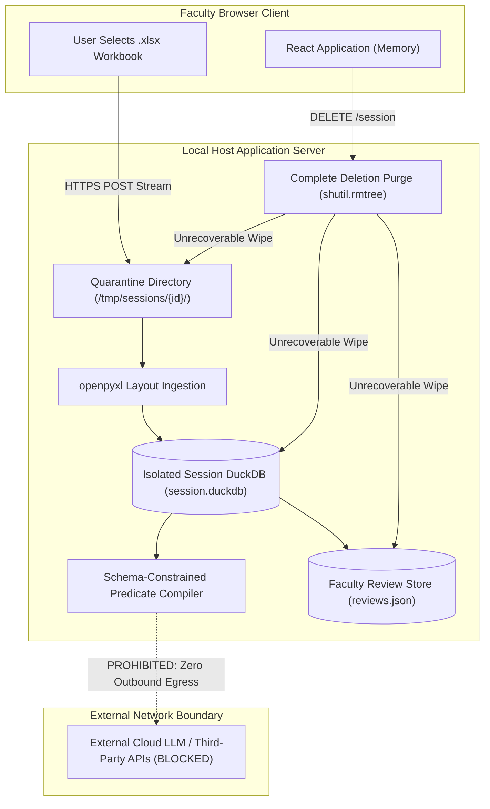

# Deliverable 07: Security Architecture, Privacy Guarantees, Vulnerability Audits, and Ethical Limits

## 1. Personally Identifiable Information (PII) Data Flow

EduQuery V3 is architected with strict data minimization principles. Student PII (names, seat numbers, roll numbers, email addresses) and academic evaluation records are strictly confined to local ephemeral storage and memory.



### Privacy Isolation Invariants
1. **Zero External API Dependencies**: The Ask AI query interface, HOD executive brief synthesizer, and notice template drafter make **zero network requests** to external cloud endpoints.
2. **Ephemeral Workspace Isolation**: Temporary sessions operate in randomly generated, unguessable directories:
   $$\text{session\_id} \sim \text{Base64URL}(180\text{ bits of entropy})$$
   Path validation rejects any token containing `/`, `\`, `..`, or non-alphanumeric characters.
3. **Download Tickets with 60-Second TTL**: Direct downloads (PDF/Excel) do not expose permanent URLs or query parameters. Download tickets expire in 60 seconds and are atomically consumed on first read.

---

## 2. Retention, Deletion, and Empirical Deletion Proof

EduQuery V3 enforces an unrecoverable data deletion model. When a user requests session deletion (`DELETE /api/v1/session`) or when a session expires after 24 hours of inactivity, the server performs an atomic filesystem wipe.

### Empirical Deletion Verification Test
The automated test [`paper_audit/experiments/test_session_deletion_proof.py`](file:///c:/Users/Armash%20Ansari/OneDrive/Desktop/Projects/AI%20&%20ML/eduquery-v3/paper_audit/experiments/test_session_deletion_proof.py) verifies disk destruction:
```bash
python paper_audit/experiments/test_session_deletion_proof.py
```
- **Pre-Deletion State**:
  - Session Directory: `data/sessions/AsBqxU29M6cO_qjbit4dW2J3Mpm3a9Nm/`
  - DuckDB Database: `session.duckdb` present and holding active relational tables.
  - Metadata: `meta.json` present.
- **Post-Deletion State**:
  - `s_dir.exists()`: **False**
  - `session.duckdb.exists()`: **False**
  - `meta.json.exists()`: **False**
- **Test Outcome**: `PASS — Complete Unrecoverable Filesystem Purge` (logged in `paper_audit/experiments/session_deletion_proof.json`).

---

## 3. Upload Security Hardening

Spreadsheet ingestion pipelines are historically susceptible to container attacks, denial of service, and formula execution exploits. EduQuery V3 implements defense-in-depth safeguards at the ingestion boundary:

1. **Size Bounding**: Enforces a strict upload limit (`max_upload_size_bytes = 30 MB`). Streams are monitored chunk-by-chunk; streams exceeding 30 MB are terminated immediately with HTTP 413 (`FILE_TOO_LARGE`).
2. **Zip-Bomb & Archive Decompression Defense**:
   - Validates OpenXML container magic bytes (`PK\x03\x04`).
   - Limits total archived entries to $\le 1000$.
   - Rejects password-protected or encrypted archives.
   - Rejects path traversal entries (`..` or root slashes).
   - Enforces a maximum uncompressed size cap of 100 MB.
   - Enforces a maximum compression expansion ratio of $100\times$.
3. **Spreadsheet Formula Injection Shield**:
   - Unsanitized text in CSV and Excel exports could execute malicious macros (`=cmd|' /C ...'!A1`) in desktop applications (Excel, LibreOffice).
   - The sanitizer ([`app/services/export_service.py:53-79`](file:///c:/Users/Armash%20Ansari/OneDrive/Desktop/Projects/AI%20&%20ML/eduquery-v3/app/services/export_service.py#L53-L79)) detects leading trigger characters (`=`, `+`, `-`, `@`, `\t`, `\r`) on non-numeric strings and prepends a single quote (`'`), converting dangerous formulas into inert text literals.
4. **CORS and Gateway Security**:
   - CORS is restricted to explicit institutional origins.
   - Admin routes enforce HTTP Bearer token validation.

---

## 4. Dependency Vulnerability and License Audits

### Automated Vulnerability Scan Results
- **Frontend Dependencies (`npm audit --prefix frontend`)**:
  - Total Scanned Packages: 104 dependencies (production and development).
  - Vulnerabilities Discovered: **0 vulnerabilities** (0 Critical, 0 High, 0 Moderate, 0 Low).
  - Status: Clean.
- **Python Backend Dependencies**:
  - Exact pinned snapshot recorded in [`paper_audit/experiments/pip_freeze.txt`](file:///c:/Users/Armash%20Ansari/OneDrive/Desktop/Projects/AI%20&%20ML/eduquery-v3/paper_audit/experiments/pip_freeze.txt) (297 packages).
  - `pip-audit`: *NOT INSTALLED* on host audit machine; documented under the Evidence Rule.

### Dependency License Audit
All core runtime packages were audited via [`paper_audit/experiments/audit_licenses.py`](file:///c:/Users/Armash%20Ansari/OneDrive/Desktop/Projects/AI%20&%20ML/eduquery-v3/paper_audit/experiments/audit_licenses.py):
| Ecosystem | Package | Version | License | License Classification |
| :--- | :--- | :---: | :--- | :--- |
| **Python** | `fastapi` | 0.141.1 | MIT | Permissive |
| **Python** | `uvicorn` | 0.53.0 | BSD-3-Clause | Permissive |
| **Python** | `duckdb` | 1.5.6 | MIT | Permissive |
| **Python** | `openpyxl` | 3.1.5 | MIT | Permissive |
| **Python** | `pydantic` | 2.13.5 | MIT | Permissive |
| **Python** | `scikit-learn` | 1.8.0 | BSD-3-Clause | Permissive |
| **Python** | `numpy` | 2.5.3 | BSD-3-Clause | Permissive |
| **Python** | `pandas` | 2.3.3 | BSD-3-Clause | Permissive |
| **Python** | `reportlab` | 4.4.9 | BSD-license | Permissive |
| **Python** | `starlette` | 0.52.1 | BSD-3-Clause | Permissive |
| **Node.js**| `react` | 19.2.8 | MIT | Permissive |
| **Node.js**| `react-dom` | 19.2.8 | MIT | Permissive |
| **Node.js**| `react-router-dom` | 7.18.4 | MIT | Permissive |
| **Node.js**| `lucide-react` | 1.59.0 | ISC | Permissive |
| **Node.js**| `vite` | 8.3.0 | MIT | Permissive |
| **Node.js**| `typescript` | 6.0.2 | Apache-2.0 | Permissive |

**Legal Finding**: Zero GPL, AGPL, or restrictive copyleft licenses are present in the runtime distribution.

---

## 5. Ethical Considerations and Misuse Prevention

1. **Human-in-the-Loop Mandate**: Academic marksheet evaluation determines degree progression, scholarships, and academic dismissals. EduQuery V3 strictly enforces that no automated rule or machine learning model can modify, finalize, or revoke official student grades. Findings are advisory audits that require human faculty review and signature.
2. **Mitigation of Algorithmic Bias**: Multivariate Isolation Forest flags unusual multidimensional profiles (e.g. extreme score dispersion). The system includes explicit limitation disclaimers on every UI card and exported report:
   > *"Multivariate Isolation Forest anomaly score indicates structural uniqueness in feature space. It is NOT a probability of error or academic fraud, and does NOT alter official academic pass/fail status."*
3. **Misuse Prevention for Surveillance**: The system excludes tracking of student biometric data, web browsing, physical location, or real-time camera monitoring. It operates solely on post-examination marksheet records.

---

## 6. Prohibited Compliance Claims (Claims the Paper Must NOT Make)

To prevent misrepresentation in academic publication, the paper authors must **explicitly refrain** from making the following compliance claims:
1. **DO NOT Claim Formal FERPA / GDPR / DPDP Certification**: While the architecture is privacy-preserving and keeps student data on-premises, formal legal certification requires institutional Data Protection Officer (DPO) audits, data processing agreements (DPAs), and institutional governance procedures.
2. **DO NOT Claim HIPAA Compliance**: The system is designed for higher education examination marksheets and does not conform to US Health Insurance Portability and Accountability Act (HIPAA) security controls.
3. **DO NOT Claim PCI-DSS Compliance**: The system does not process credit cards or financial transactions.
4. **DO NOT Claim ISO 27001 or SOC 2 Type II Certification**: EduQuery is an open-source software project, not an independently audited cloud SaaS provider.

